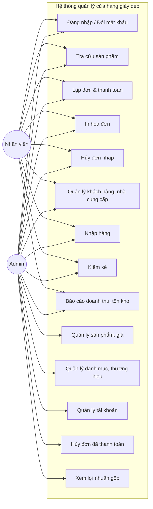
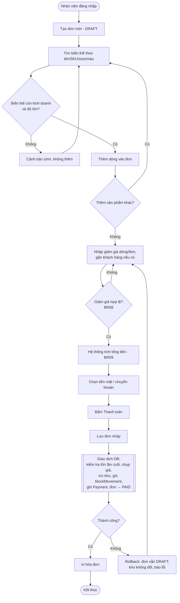
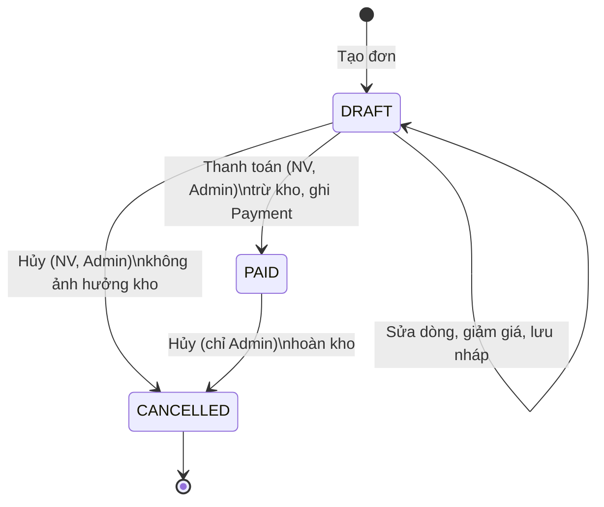
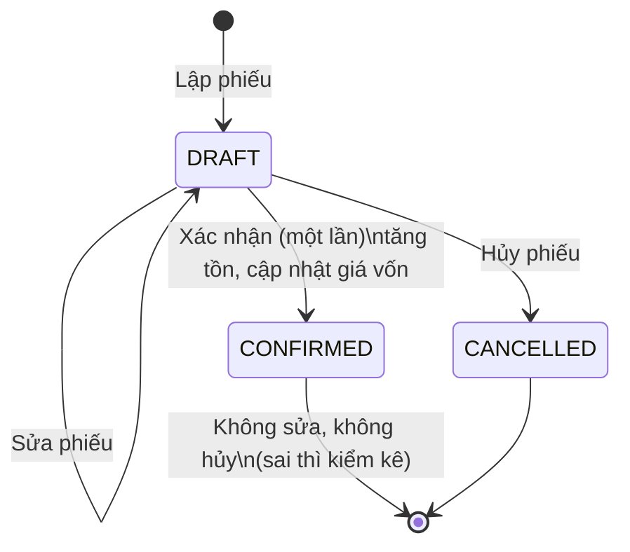
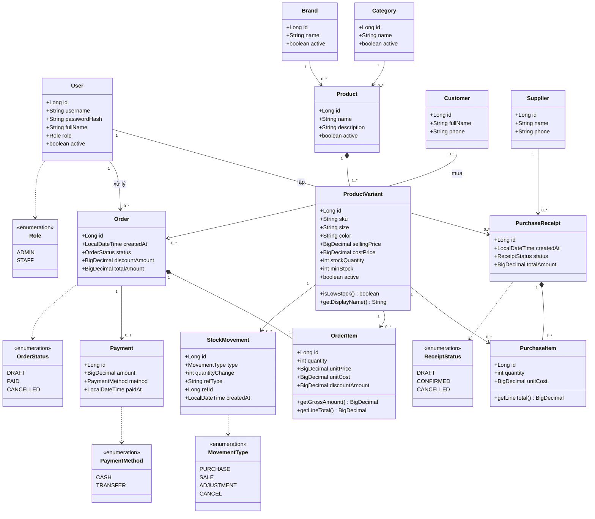
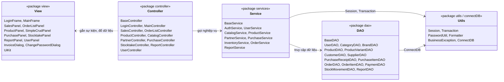
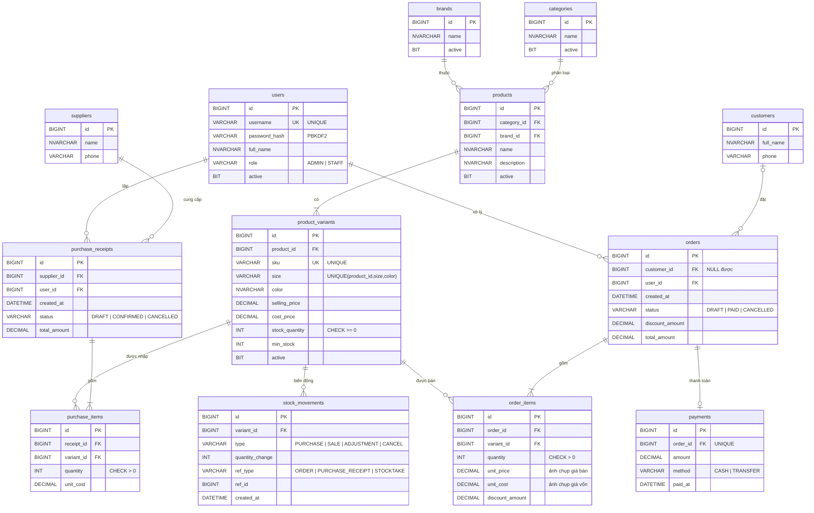
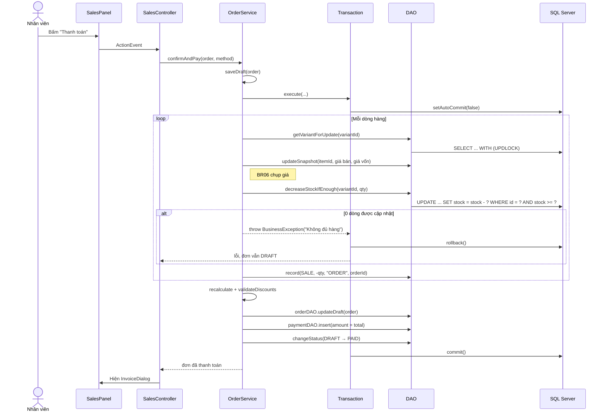

# BÁO CÁO ĐỒ ÁN: HỆ THỐNG QUẢN LÝ CỬA HÀNG GIÀY DÉP

**Công nghệ:** Java Swing, JDBC, Microsoft SQL Server
**Kiến trúc:** View → Controller → Service → DAO → Database (Model dùng xuyên suốt)

---

## MỤC LỤC

1. [Phân tích chi tiết nghiệp vụ](#1-phân-tích-chi-tiết-nghiệp-vụ)
2. [Sơ đồ class và sơ đồ cơ sở dữ liệu](#2-sơ-đồ-class-và-sơ-đồ-cơ-sở-dữ-liệu)
3. [Chi tiết thực hiện](#3-chi-tiết-thực-hiện)

---

## 1. PHÂN TÍCH CHI TIẾT NGHIỆP VỤ

### 1.1. Bài toán và phạm vi

Hệ thống phục vụ **một cửa hàng giày dép bán trực tiếp tại quầy**. Cửa hàng cần:

- Quản lý sản phẩm theo **mẫu giày** và **biến thể size/màu** (mỗi biến thể có SKU, giá bán, giá vốn, tồn kho riêng).
- Nhập hàng từ nhà cung cấp, kiểm kê kho.
- Bán hàng: lập đơn, giảm giá, thanh toán, in hóa đơn, hủy đơn.
- Báo cáo doanh thu, lợi nhuận, hàng bán chạy, tồn kho.

**Ngoài phạm vi:** đổi trả hàng, bán online, giao vận, thuế VAT / hóa đơn điện tử, nhiều kho/chi nhánh, khuyến mãi phức tạp.

### 1.2. Tác nhân và quyền hạn

| Vai trò | Được phép |
|---|---|
| **Admin** | Toàn quyền: quản lý tài khoản, danh mục, thương hiệu, sản phẩm và giá; hủy đơn đã thanh toán; giảm giá không giới hạn; xem giá vốn và lợi nhuận |
| **Nhân viên (Staff)** | Tra cứu sản phẩm, lập đơn và thanh toán, hủy đơn nháp, quản lý khách hàng và nhà cung cấp, nhập hàng, kiểm kê, xem báo cáo doanh thu và tồn kho; giảm giá tối đa 20% tổng đơn |



### 1.3. Các nhóm chức năng

#### a) Quản lý sản phẩm
- Thêm, sửa, ngừng kinh doanh **mẫu giày** (Product) và **biến thể** (ProductVariant).
- Mẫu giày gắn với **một danh mục** và **một thương hiệu**.
- Mỗi biến thể là một tổ hợp **size + màu** của mẫu giày, có **SKU duy nhất**, giá bán, giá vốn, ngưỡng tồn tối thiểu.
- Không xóa cứng sản phẩm/biến thể đã phát sinh giao dịch, chỉ chuyển sang "ngừng kinh doanh".

#### b) Nhập hàng và kho
- Quản lý nhà cung cấp.
- Lập **phiếu nhập** (nhà cung cấp, danh sách biến thể, số lượng, giá nhập). Phiếu ở trạng thái **Nháp**, sửa được. Khi **xác nhận** thì tồn kho tăng và giá vốn được cập nhật.
- **Kiểm kê**: nhập số lượng thực tế đếm được; hệ thống tự tạo điều chỉnh chênh lệch.
- Mọi thay đổi tồn kho đều được ghi vào **lịch sử biến động** (StockMovement).

#### c) Bán hàng
- Tìm biến thể theo tên, SKU, thương hiệu, size, màu.
- Lập đơn: thêm dòng, sửa số lượng, giảm giá theo dòng hoặc theo đơn.
- Gắn khách hàng vào đơn (không bắt buộc).
- Thanh toán tiền mặt hoặc chuyển khoản, in hóa đơn, hủy đơn.

#### d) Báo cáo
- Doanh thu theo ngày / tháng / năm, số đơn, lợi nhuận gộp.
- Sản phẩm bán chạy, tồn kho, hàng dưới ngưỡng tồn tối thiểu, tổng giá trị nhập.

### 1.4. Quy tắc nghiệp vụ

| Mã | Nhóm | Quy tắc | Ý nghĩa thực tế |
|---|---|---|---|
| **BR01** | Sản phẩm | SKU là duy nhất. Mỗi biến thể là một tổ hợp size + màu của một Product, không trùng | Tránh hai mã hàng cho cùng một đôi giày |
| **BR02** | Sản phẩm | Đã có trong đơn/phiếu nhập thì chỉ được ngừng kinh doanh, không xóa. Biến thể ngừng KD không thể thêm vào đơn mới | Giữ nguyên lịch sử chứng từ |
| **BR03** | Tồn kho | Tồn kho không âm. Mọi thay đổi tồn đều ghi StockMovement | Truy vết được mọi thay đổi kho |
| **BR04** | Tồn kho | Phiếu nhập chỉ tăng tồn khi chuyển sang CONFIRMED, chỉ xác nhận một lần. Đã xác nhận thì không sửa; sai thì kiểm kê | Chống cộng kho hai lần |
| **BR05** | Bán hàng | Chỉ xác nhận đơn khi đủ tồn. Kiểm tra, trừ kho, ghi thanh toán trong **một giao dịch**; lỗi thì hoàn tác toàn bộ | Không có đơn "nửa vời" |
| **BR06** | Bán hàng | Giá bán và giá vốn được chụp lại vào OrderItem tại thời điểm bán | Đổi giá sau này không làm sai đơn cũ |
| **BR07** | Giá vốn | Giá vốn = giá nhập gần nhất từ phiếu đã xác nhận. Lợi nhuận gộp = doanh thu thuần − Σ(giá vốn × SL) | Cách tính đơn giản hóa cho đồ án |
| **BR08** | Giảm giá | Giảm theo số tiền trên dòng hoặc đơn, không vượt thành tiền. Nhân viên tối đa 20% tổng đơn; Admin không giới hạn | Kiểm soát giảm giá |
| **BR09** | Tính tiền | Tổng tiền = Σ(SL × đơn giá − giảm dòng) − giảm cấp đơn. Luôn tính lại, không nhập tay | Chống sai số liệu |
| **BR10** | Thanh toán | Mỗi đơn đúng một Payment, số tiền bằng tổng tiền đơn | Không trả góp |
| **BR11** | Hủy đơn | Đơn DRAFT hủy tự do, không ảnh hưởng kho. Đơn PAID chỉ Admin được hủy, hoàn kho và ghi StockMovement | Kiểm soát hoàn tiền |
| **BR12** | Phân quyền | Mỗi người dùng đúng một vai trò. Vai trò quyết định màn hình/nút hiển thị; Service vẫn kiểm tra lại | Bảo mật hai lớp |

### 1.5. Luồng bán hàng tại quầy



### 1.6. Vòng đời trạng thái

**Đơn hàng (Order):**



**Phiếu nhập (PurchaseReceipt):**



Trạng thái kết thúc (CANCELLED; CONFIRMED của phiếu nhập) không được quay lại.

---

## 2. SƠ ĐỒ CLASS VÀ SƠ ĐỒ CƠ SỞ DỮ LIỆU

### 2.1. Sơ đồ class nghiệp vụ (Model – 13 lớp)



**Ghi chú:**
- `OrderItem` lưu **ảnh chụp** `unitPrice`, `unitCost` tại thời điểm bán (BR06).
- `ProductVariant.stockQuantity` luôn bằng tổng `quantityChange` của các `StockMovement` của biến thể đó (dùng để đối soát).
- Ngoài thuộc tính nghiệp vụ, model có thêm các trường chỉ để hiển thị (ví dụ `productName`, `supplierName`, `customerName`) được DAO điền khi JOIN, không lưu xuống bảng.

### 2.2. Sơ đồ kiến trúc phân lớp



Nguyên tắc: **View không gọi SQL**. View chỉ chứa thành phần Swing; Controller bắt sự kiện và gọi Service; Service kiểm tra quy tắc nghiệp vụ và quyền; DAO chạy SQL bằng JDBC.

### 2.3. Sơ đồ cơ sở dữ liệu (ERD)



**Ràng buộc quan trọng** (file `database/schema.sql`):

| Ràng buộc | Quy tắc |
|---|---|
| `UNIQUE (sku)`, `UNIQUE (product_id, size, color)` | BR01 |
| `CHECK (stock_quantity >= 0)` | BR03 – lớp bảo vệ cuối cùng ở DB |
| `UNIQUE (payments.order_id)` | BR10 – một đơn một thanh toán |
| `UNIQUE (users.username)`, `CHECK role IN ('ADMIN','STAFF')` | BR12 |
| `CHECK status IN (...)` trên `orders`, `purchase_receipts` | Vòng đời trạng thái |
| `CHECK quantity > 0` trên `order_items`, `purchase_items` | Dữ liệu hợp lệ |

---

## 3. CHI TIẾT THỰC HIỆN

### 3.1. Cấu trúc mã nguồn

```
app/            Main.java – điểm khởi động
connectDB/      ConnectDB – kết nối SQL Server dùng chung
model/          13 lớp nghiệp vụ + 5 enum
dto/            RevenueRow, ProductSalesRow – dữ liệu báo cáo
dao/            BaseDAO + 14 DAO (JDBC)
services/       BaseService + 9 Service (nghiệp vụ, BR01–BR12)
controller/     BaseController + 11 Controller (xử lý sự kiện)
view/           UiKit + các JFrame/JPanel/JDialog
utils/          Session, Transaction, PasswordUtil, Formatter, BusinessException
database/       schema.sql, update_from_old_script.sql
```

### 3.2. Hạ tầng dùng chung

| Lớp | Nhiệm vụ | Cách làm |
|---|---|---|
| `ConnectDB` | Kết nối SQL Server | Singleton, **một kết nối dùng chung**; tự kết nối lại nếu đã đóng; đọc `db.properties` nếu có; khi lỗi giữ lại thông báo gốc của driver để hiển thị cho người dùng |
| `BaseDAO` | Lớp cha của DAO | `conn()` lấy kết nối dùng chung; hàm gán tham số có thể NULL (`setLong`, `setTimestamp`); `executeInsert` trả về khóa tự tăng. **DAO không đóng Connection**, chỉ đóng Statement/ResultSet, và ném `SQLException` lên Service |
| `Transaction` | Giao dịch JDBC | `Transaction.execute(conn -> {...})`: `setAutoCommit(false)` → chạy khối lệnh → `commit()`; có bất kỳ lỗi nào (SQL hoặc nghiệp vụ) thì `rollback()`. Vì mọi DAO dùng chung một kết nối nên các lệnh DAO bên trong khối tự động thuộc cùng giao dịch |
| `BaseService` | Lớp cha của Service | `db(...)` bọc `SQLException` thành `BusinessException` có thông báo tiếng Việt; các hàm kiểm tra `required`, `phone`, `nonNegative` |
| `BusinessException` | Lỗi nghiệp vụ | Mọi vi phạm BR ném ra lỗi này, Controller hiện thẳng nội dung cho người dùng |
| `Session` | Người dùng đăng nhập | `requireLogin()`, `requireAdmin()`, `isAdmin()` – dùng cho BR12 |
| `PasswordUtil` | Băm mật khẩu | PBKDF2WithHmacSHA256 (có sẵn trong JDK), salt ngẫu nhiên 16 byte, 65 536 vòng lặp; lưu dạng `pbkdf2$vòng$salt$hash`; so sánh bằng `MessageDigest.isEqual` |
| `BaseController` | Lớp cha của Controller | `handle(action)` chạy hành động, bắt `BusinessException` để hiện hộp thoại lỗi, đổi con trỏ chuột sang chờ |
| `UiKit` | Dựng giao diện | Bảng chỉ đọc, form lưới, nút, ô chọn ngày, hộp thoại thông báo/xác nhận |

### 3.3. Đăng nhập và phân quyền (BR12)

| Tầng | Lớp |
|---|---|
| View | `LoginFrame`, `MainFrame`, `ChangePasswordDialog` |
| Controller | `LoginController`, `MainController` |
| Service | `AuthService` |
| DAO | `UserDAO` |

**Nghiệp vụ:**
- `AuthService.login()`: tìm user theo username → `PasswordUtil.verify()` → kiểm tra `active` → lưu vào `Session`. Sai tài khoản hay sai mật khẩu đều báo chung một thông báo để không lộ username nào tồn tại.
- `MainController` dựng các tab **theo vai trò**: tab *Danh mục*, *Thương hiệu*, *Tài khoản* chỉ thêm khi `Session.isAdmin()`; nhân viên thấy tab "Tra cứu sản phẩm" (form sửa bị ẩn, cột giá vốn bị ẩn). Mỗi tab có một hàm `refresh` được gọi khi người dùng chuyển tới tab đó.
- **Phân quyền hai lớp:** dù nút bị ẩn, mọi phương thức Service vẫn gọi `Session.requireLogin()` hoặc `Session.requireAdmin()` ở dòng đầu tiên.
- `AuthService.changePassword()`: kiểm tra mật khẩu cũ, mật khẩu mới ≥ 6 ký tự, nhập lại khớp.

### 3.4. Quản lý tài khoản (chỉ Admin)

| Tầng | Lớp |
|---|---|
| View | `UserPanel` |
| Controller | `UserController` |
| Service | `UserService` |
| DAO | `UserDAO` |

**Nghiệp vụ trong `UserService`:**
- `create()`: username 3–50 ký tự không dấu và chưa tồn tại; bắt buộc chọn một vai trò; mật khẩu được băm trước khi lưu.
- `update()`: **không cho tự khóa hoặc tự hạ quyền** tài khoản đang đăng nhập; **không cho mất Admin cuối cùng** (`UserDAO.countActiveAdmins()`).
- `resetPassword()`: Admin đặt lại mật khẩu cho tài khoản khác.

### 3.5. Quản lý sản phẩm (BR01, BR02)

| Tầng | Lớp |
|---|---|
| View | `ProductPanel` (bảng mẫu giày + form, bảng biến thể + form) |
| Controller | `ProductController` |
| Service | `ProductService` |
| DAO | `ProductDAO`, `ProductVariantDAO` |

**Tìm kiếm:** `ProductDAO.searchProducts(keyword, categoryId, brandId, active)` dùng mẫu `(? IS NULL OR cột = ?)` để một câu SQL phục vụ mọi tổ hợp bộ lọc; từ khóa khớp tên sản phẩm, thương hiệu, hoặc SKU/size/màu của biến thể (`EXISTS`).

**Lưu biến thể – `ProductService.saveVariant()`:**
1. `Session.requireAdmin()` – chỉ Admin sửa sản phẩm và giá.
2. Bắt buộc SKU, size, màu; giá bán > 0; ngưỡng tồn ≥ 0. SKU được chuẩn hóa thành chữ in hoa.
3. **BR01:** `ProductVariantDAO.existsSku(sku, excludeId)` và `existsSizeColor(productId, size, color, excludeId)`. Tham số `excludeId` giúp khi sửa không báo trùng với chính nó.
4. Không cho bật bán biến thể nếu mẫu giày đang ngừng kinh doanh.
5. Thêm mới: tồn ban đầu luôn = 0 (tồn chỉ tăng qua nhập hàng/kiểm kê). Sửa: **không đổi tồn và giá vốn** (`updateVariant` không ghi hai cột này).

**Xóa – BR02:**
```java
// ProductService.deleteProduct()
return Transaction.execute(conn -> {
    if (productDAO.hasTransactions(productId)) {   // có trong đơn / phiếu nhập / lịch sử kho
        productDAO.updateProductStatus(productId, false);
        variantDAO.deactivateByProduct(productId);  // ngừng luôn mọi biến thể
        return false;                               // chỉ ngừng kinh doanh
    }
    productDAO.deleteProduct(productId);            // chưa giao dịch -> xóa hẳn
    return true;
});
```
`hasTransactions()` kiểm tra `EXISTS` trong `order_items`, `purchase_items`, `stock_movements`. Tương tự cho `deleteVariant()`. Khi sửa mẫu giày sang "ngừng kinh doanh", `saveProduct()` cũng ngừng toàn bộ biến thể trong cùng giao dịch.

### 3.6. Danh mục, thương hiệu, khách hàng, nhà cung cấp

| Chức năng | View | Controller | Service | DAO |
|---|---|---|---|---|
| Danh mục / Thương hiệu (Admin) | `SimpleCrudPanel` | `CatalogController` (`Kind.CATEGORY` / `Kind.BRAND`) | `CatalogService` | `CategoryDAO`, `BrandDAO` |
| Khách hàng / Nhà cung cấp | `SimpleCrudPanel` | `PartnerController` (`Kind.CUSTOMER` / `Kind.SUPPLIER`) | `PartnerService` | `CustomerDAO`, `SupplierDAO` |

`SimpleCrudPanel` là một khung giao diện dùng chung (ô tìm kiếm, bảng, form 1–2 trường, nút Thêm/Lưu/Xóa); mỗi màn hình chỉ khác tham số tiêu đề và cột.

**Nghiệp vụ:**
- Danh mục/thương hiệu: tên không trùng (không phân biệt hoa thường). Xóa: nếu đã có sản phẩm thì chỉ chuyển "ngừng dùng" (`countProducts > 0`), ngược lại xóa hẳn.
- Khách hàng: số điện thoại 9–11 chữ số và **không trùng khách khác** (`findByPhone`); không xóa khách đã có đơn.
- Nhà cung cấp: không xóa nhà cung cấp đã có phiếu nhập.

### 3.7. Nhập hàng (BR03, BR04, BR07)

| Tầng | Lớp |
|---|---|
| View | `PurchasePanel` (tab *Lập phiếu nhập*, tab *Danh sách phiếu nhập*) |
| Controller | `PurchaseController` |
| Service | `PurchaseService` |
| DAO | `PurchaseReceiptDAO`, `PurchaseItemDAO`, `ProductVariantDAO`, `StockMovementDAO` |

**Lập phiếu – `createPurchaseReceipt(supplierId, items)`:** kiểm tra nhà cung cấp, danh sách không rỗng, không lặp biến thể, SL > 0, giá nhập ≥ 0; tính tổng = Σ(SL × giá nhập); lưu phiếu **trạng thái DRAFT** cùng các dòng trong một giao dịch. **Tồn kho chưa thay đổi.**

**Sửa phiếu – `updateDraft()`:** câu lệnh `UPDATE purchase_receipts ... WHERE id = ? AND status = 'DRAFT'`; nếu 0 dòng bị ảnh hưởng nghĩa là phiếu đã xác nhận/hủy → báo lỗi BR04. Sau đó xóa và ghi lại toàn bộ dòng chi tiết.

**Xác nhận – `confirmReceipt(receiptId)`:** toàn bộ trong `Transaction.execute`:
```java
// 1. Đổi trạng thái có điều kiện -> đảm bảo chỉ xác nhận MỘT lần (BR04)
if (!purchaseReceiptDAO.changeStatus(id, DRAFT, CONFIRMED))
    throw new BusinessException("Phiếu không ở trạng thái Nháp ...");
for (PurchaseItem item : purchaseItemDAO.findByReceiptId(id)) {
    productVariantDAO.increaseStock(item.getVariantId(), item.getQuantity()); // tăng tồn
    productVariantDAO.updateCostPrice(item.getVariantId(), item.getUnitCost()); // BR07
    stockMovementDAO.record(variantId, PURCHASE, +qty, "PURCHASE_RECEIPT", id); // BR03
}
```
`changeStatus` dùng `UPDATE ... SET status = ? WHERE id = ? AND status = ?`. Nếu hai người bấm xác nhận cùng lúc, chỉ một câu UPDATE trả về 1 dòng; người còn lại nhận 0 dòng và giao dịch bị rollback → không cộng kho hai lần.

**Hủy phiếu – `cancelReceipt()`:** chỉ DRAFT → CANCELLED. Phiếu đã xác nhận không hủy được, phải điều chỉnh bằng kiểm kê.

**Giao diện:** chọn biến thể thì ô giá nhập tự gợi ý giá vốn hiện tại; thêm cùng biến thể hai lần sẽ cộng dồn số lượng; nút *Lưu & Xác nhận nhập kho* lưu nháp rồi hỏi xác nhận.

### 3.8. Kiểm kê và lịch sử tồn kho (BR03)

| Tầng | Lớp |
|---|---|
| View | `StocktakePanel` (tab *Kiểm kê*, tab *Lịch sử biến động*) |
| Controller | `StocktakeController` |
| Service | `InventoryService` |
| DAO | `ProductVariantDAO`, `StockMovementDAO` |

**Kiểm kê – `applyStocktake(Map<variantId, số thực tế>)`:**
```java
Transaction.execute(conn -> {
    for (each variantId, actual) {
        ProductVariant v = variantDAO.getVariantForUpdate(variantId); // WITH (UPDLOCK, ROWLOCK)
        int diff = actual - v.getStockQuantity();
        if (diff == 0) continue;
        variantDAO.updateStock(v.getId(), actual);
        movementDAO.record(v.getId(), ADJUSTMENT, diff, "STOCKTAKE", null);
    }
});
```
`getVariantForUpdate` khóa dòng biến thể đến hết giao dịch, tránh trường hợp máy khác đang bán làm tồn thay đổi giữa lúc đọc và ghi. Số thực tế âm bị từ chối.

**Giao diện:** bảng có cột *Thực tế* sửa trực tiếp, cột *Chênh lệch* tự tính khi gõ; lọc nhanh theo SKU/tên, tùy chọn chỉ hiện dòng chênh lệch; trước khi áp dụng hiện danh sách thay đổi để xác nhận.

**Đối soát – `reconcile()`:** `StockMovementDAO.findMismatches()` so `stock_quantity` với `SUM(quantity_change)` của từng biến thể và liệt kê các biến thể bị lệch.

**Lịch sử biến động:** lọc theo loại (nhập/bán/điều chỉnh/hủy đơn), SKU, khoảng ngày; hiển thị chứng từ tham chiếu (ví dụ `ORDER #12`).

### 3.9. Bán hàng tại quầy (BR02, BR03, BR05, BR06, BR08, BR09, BR10)

| Tầng | Lớp |
|---|---|
| View | `SalesPanel`, `InvoiceDialog` |
| Controller | `SalesController` |
| Service | `OrderService`, `ProductService`, `PartnerService` |
| DAO | `OrderDAO`, `OrderItemDAO`, `PaymentDAO`, `ProductVariantDAO`, `StockMovementDAO`, `CustomerDAO` |

**Bước 1 – Tạo đơn:** `OrderService.newOrder()` tạo đơn DRAFT trong bộ nhớ, gắn nhân viên đang đăng nhập.

**Bước 2 – Thêm dòng:** `addItem(order, variantId, qty)`:
- Biến thể ngừng kinh doanh → từ chối (BR02).
- Nếu biến thể đã có trong đơn thì cộng dồn số lượng.
- **Cảnh báo sớm:** tổng số lượng > tồn hiện tại → báo "Không đủ hàng: ... chỉ còn N".
- Màn hình chỉ tìm biến thể đang kinh doanh (`searchVariants(..., onlyActive = true)`); nhấp đúp để thêm nhanh.

**Bước 3 – Giảm giá, khách hàng, tính tiền:**
```java
// BR09 – OrderService.recalculate()
subtotal = Σ (quantity × unitPrice − discountLine)
total    = subtotal − orderDiscount

// BR08 – OrderService.validateDiscounts(order, user)
discountLine  ≤ quantity × unitPrice     (từng dòng, không âm)
orderDiscount ≤ subtotal                 (không âm)
if (user là STAFF)
    (Σ discountLine + orderDiscount) ≤ 20% × Σ(quantity × unitPrice)
```
Controller gọi `validateDiscounts` ngay khi nhập giảm giá; nếu vi phạm thì trả lại giá trị cũ. Khách hàng tìm theo SĐT/tên; không tìm thấy thì cho thêm nhanh khách mới.

**Bước 4–5 – Thanh toán `confirmAndPay(order, method)`:**

1. `saveDraft(order)` (giao dịch riêng): lấy lại giá bán hiện tại, kiểm tra biến thể còn kinh doanh, kiểm tra giảm giá, lưu đơn DRAFT và các dòng. Nhờ bước này, nếu thanh toán lỗi thì đơn vẫn còn là nháp trong DB.
2. Giao dịch xác nhận:



Các điểm then chốt:
- **BR05 – chống bán vượt tồn:** trừ kho bằng câu `UPDATE` có điều kiện; nếu hai máy cùng bán món cuối cùng, chỉ một câu thành công, máy còn lại nhận 0 dòng → rollback. Ràng buộc `CHECK (stock_quantity >= 0)` ở DB là lớp bảo vệ cuối.
- **BR06:** `unit_price`, `unit_cost` được ghi lại vào `order_items` trong giao dịch; báo cáo lợi nhuận dùng ảnh chụp này nên đổi giá sau không ảnh hưởng đơn cũ.
- **BR10:** kiểm tra `paymentDAO.existsForOrder()` trước khi ghi; số tiền thanh toán = tổng tiền đã tính lại; DB có `UNIQUE (payments.order_id)`.
- Đơn chỉ chuyển `DRAFT → PAID` bằng câu đổi trạng thái có điều kiện, tránh hai máy cùng thanh toán một đơn.

**Bước 6 – Hóa đơn:** `OrderService.buildInvoice(orderId)` tạo hóa đơn dạng văn bản (cửa hàng, số HĐ, ngày, thu ngân, khách, từng dòng, giảm giá, tổng, phương thức thanh toán). `InvoiceDialog` hiển thị và in qua `JTextArea.print()`.

**Hỗ trợ khác:** ô *Khách đưa* tự tính tiền thối; *Lưu nháp* để thanh toán sau; *Hủy đơn* với đơn nháp.

### 3.10. Danh sách đơn và hủy đơn (BR11)

| Tầng | Lớp |
|---|---|
| View | `OrderListPanel` |
| Controller | `OrderListController` |
| Service | `OrderService` |
| DAO | `OrderDAO`, `OrderItemDAO`, `ProductVariantDAO`, `StockMovementDAO` |

- Tìm đơn theo khoảng ngày, trạng thái, mã đơn hoặc tên/SĐT khách; xem chi tiết dòng hàng; xem/in lại hóa đơn.
- **Mở đơn nháp:** `MainController` truyền cho `OrderListController` một hàm callback; khi bấm, tab chuyển sang *Bán hàng* và `SalesController.openDraft(id)` nạp lại đơn để tiếp tục.

**Hủy đơn – `OrderService.cancelOrder(orderId)`:**
```java
if (status == DRAFT) {
    orderDAO.changeStatus(id, DRAFT, CANCELLED);   // tự do, không đụng kho
    return;
}
if (!Session.isAdmin()) throw ...("Chỉ Admin được hủy đơn đã thanh toán (BR11)");
Transaction.execute(conn -> {
    orderDAO.changeStatus(id, PAID, CANCELLED);
    for (OrderItem it : itemDAO.findByOrderId(id)) {
        variantDAO.increaseStock(it.getVariantId(), it.getQuantity()); // hoàn kho
        movementDAO.record(it.getVariantId(), CANCEL, +qty, "ORDER", id);
    }
});
```
Đơn CANCELLED không thể hủy lại hay quay về trạng thái khác.

### 3.11. Báo cáo (BR07, BR12)

| Tầng | Lớp |
|---|---|
| View | `ReportPanel` (tab Doanh thu, Bán chạy, Tồn kho, Dưới ngưỡng tồn, Nhập hàng) |
| Controller | `ReportController` |
| Service | `ReportService` |
| DAO | `ReportDAO`, `ProductVariantDAO` |
| DTO | `RevenueRow`, `ProductSalesRow` |

**Doanh thu theo kỳ – `ReportDAO.revenueByPeriod(from, to, groupSize)`:**
```sql
SELECT CONVERT(VARCHAR(n), o.created_at, 120) AS period,   -- n = 10 ngày | 7 tháng | 4 năm
       COUNT(*) AS order_count,
       SUM(o.total_amount) AS revenue,                     -- doanh thu thuần (sau giảm giá)
       SUM(c.cost) AS cost
FROM orders o
CROSS APPLY (SELECT ISNULL(SUM(oi.quantity * oi.unit_cost), 0) AS cost
             FROM order_items oi WHERE oi.order_id = o.id) c
WHERE o.status = 'PAID' AND o.created_at >= ? AND o.created_at < ?
GROUP BY CONVERT(VARCHAR(n), o.created_at, 120)
```
- `CONVERT(..., 120)` cho chuỗi `yyyy-mm-dd hh:mi:ss`; cắt 10/7/4 ký tự đầu là nhóm theo ngày/tháng/năm, một câu SQL dùng cho cả ba cách nhóm.
- Giá vốn tính bằng `CROSS APPLY` theo từng đơn để không bị nhân đôi khi JOIN.
- **Lợi nhuận gộp** = `revenue − cost` (`RevenueRow.getGrossProfit()`, BR07).
- Chỉ tính đơn PAID; khoảng ngày là `[từ ngày 00:00, đến ngày + 1 00:00)`.

**Các báo cáo khác:**
- Bán chạy: `SELECT TOP (?)` nhóm theo biến thể, sắp theo số lượng bán.
- Tồn kho: toàn bộ biến thể; dòng dưới ngưỡng được tô đỏ (`LowStockRenderer`).
- Dưới ngưỡng: `stock_quantity < min_stock`, kèm số lượng cần nhập thêm.
- Nhập hàng: tổng giá trị và số phiếu nhập CONFIRMED trong kỳ; giá trị tồn kho theo giá vốn.

**BR12 trong báo cáo:** với nhân viên, `ReportService.revenue()` đặt `cost = null`, `inventoryValue()` gọi `requireAdmin()`, và `ReportPanel.setAdminMode(false)` ẩn cột giá vốn, lợi nhuận và ô giá trị tồn kho.

### 3.12. Bảng tổng hợp: quy tắc nghiệp vụ → mã nguồn

| Quy tắc | Service | DAO / Database |
|---|---|---|
| BR01 | `ProductService.saveVariant` | `ProductVariantDAO.existsSku`, `existsSizeColor`; UNIQUE trong DB |
| BR02 | `ProductService.deleteProduct/deleteVariant/saveProduct`, `OrderService.addItem/saveDraft/confirmAndPay` | `hasTransactions`, `deactivateByProduct` |
| BR03 | `PurchaseService`, `InventoryService`, `OrderService` | `decreaseStockIfEnough`, `StockMovementDAO.record`; `CHECK stock_quantity >= 0` |
| BR04 | `PurchaseService.confirmReceipt/updateDraft/cancelReceipt` | `PurchaseReceiptDAO.changeStatus/updateDraft` (UPDATE có điều kiện) |
| BR05 | `OrderService.confirmAndPay` | `utils.Transaction`, `getVariantForUpdate`, `decreaseStockIfEnough` |
| BR06 | `OrderService.confirmAndPay` | `OrderItemDAO.updateSnapshot` |
| BR07 | `PurchaseService.confirmReceipt`, `ReportService.revenue` | `updateCostPrice`, `ReportDAO.revenueByPeriod` |
| BR08 | `OrderService.validateDiscounts` | — |
| BR09 | `OrderService.recalculate` | — |
| BR10 | `OrderService.confirmAndPay` | `PaymentDAO.existsForOrder/insert`; UNIQUE `payments.order_id` |
| BR11 | `OrderService.cancelOrder` | `OrderDAO.changeStatus`, `increaseStock` |
| BR12 | `Session.requireAdmin()` trong mọi Service ghi dữ liệu nhạy cảm | `MainController`, `setAdminMode` của các Panel |

### 3.13. Kiểm thử đã thực hiện

| Nội dung | Kết quả |
|---|---|
| Biên dịch toàn bộ dự án (Java 21, `-Xlint:all`) | Không lỗi |
| 24 ca kiểm thử logic không cần DB: tính tổng tiền BR09, giảm giá BR08 (dưới/đúng/vượt 20%, Admin không giới hạn, giảm vượt thành tiền, giảm âm), phân quyền BR12, kiểm tra dữ liệu nhập | 24/24 đạt |
| Chụp màn hình giao diện với dữ liệu mẫu | Bố cục hiển thị đúng |
| Đăng nhập khi SQL Server không chạy | Báo lỗi rõ ràng kèm nguyên nhân |

Chưa chạy kiểm thử tích hợp với SQL Server thật; các câu SQL cần được chạy thử trên máy có SQL Server với dữ liệu từ `database/schema.sql`.

### 3.14. Hướng dẫn chạy

1. Chạy `database/schema.sql` trong SQL Server Management Studio.
2. Nếu thông tin kết nối khác mặc định, chép `db.properties.example` thành `db.properties` và sửa.
3. Chạy lớp `app.Main`. Tài khoản mẫu: `admin` / `123456` (Admin), `staff1` / `123456` (Nhân viên).
