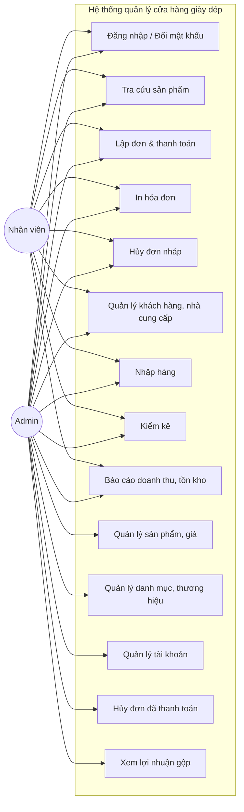
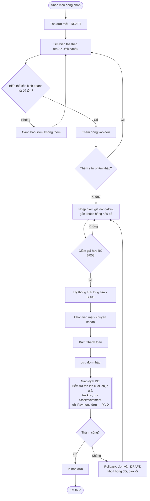
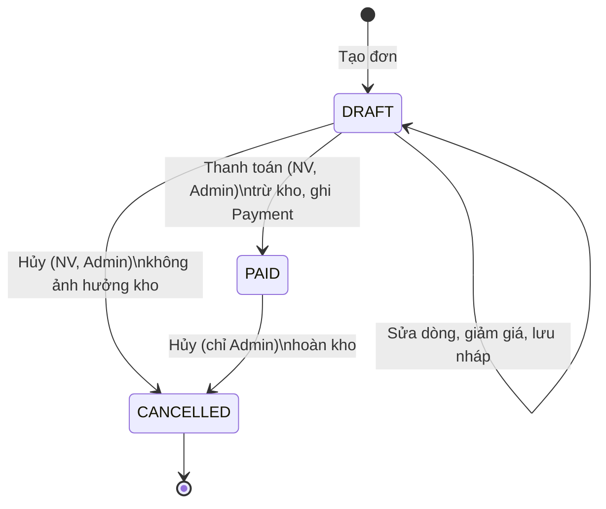
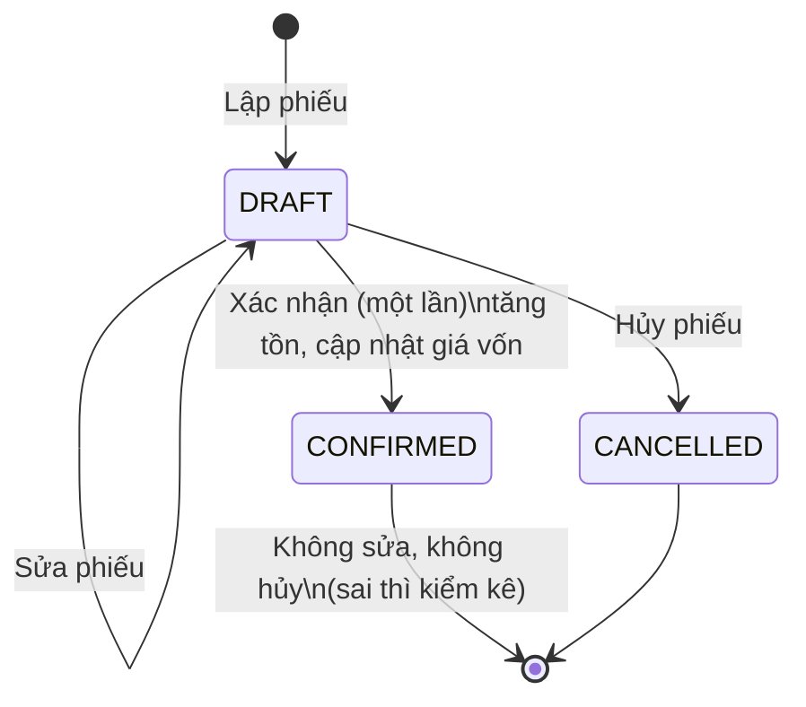
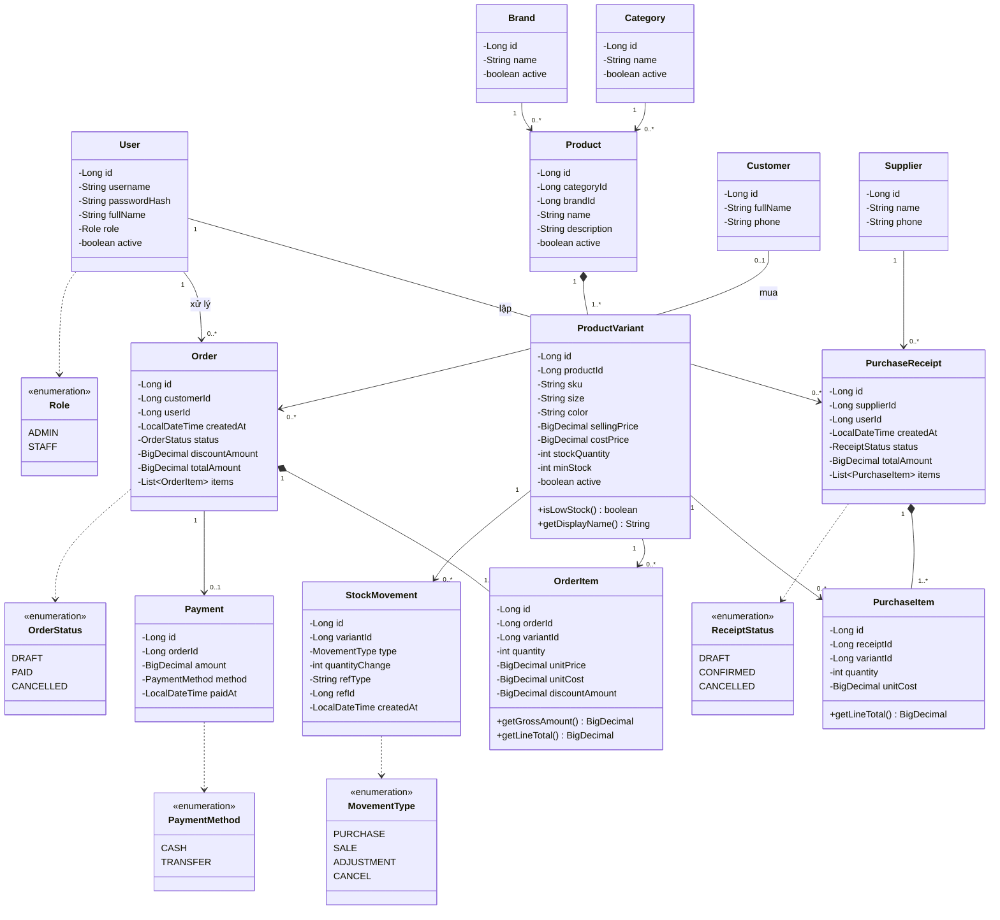
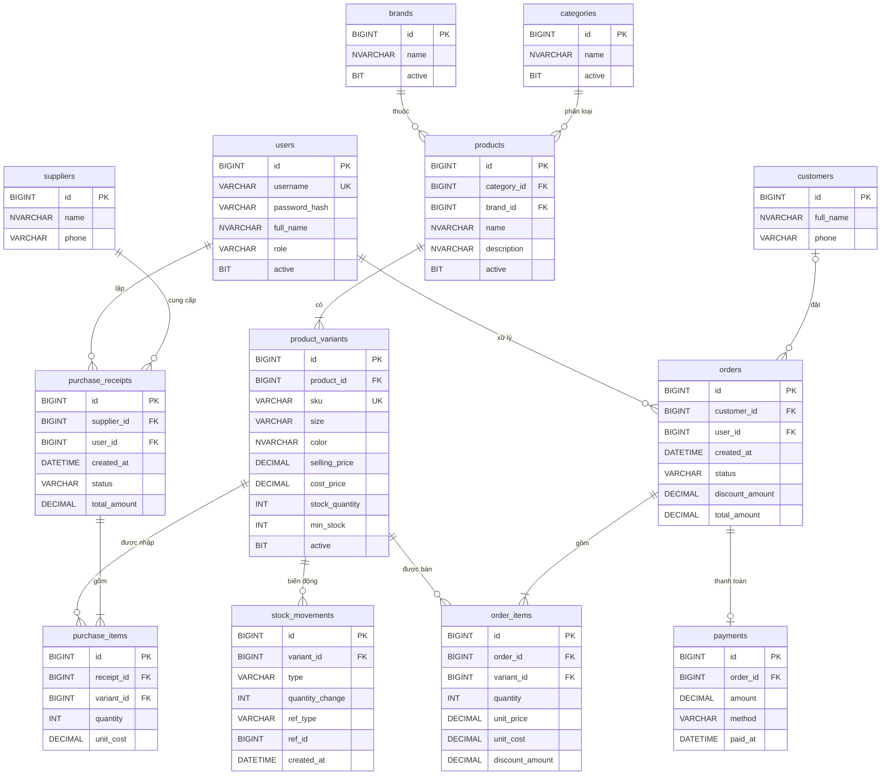
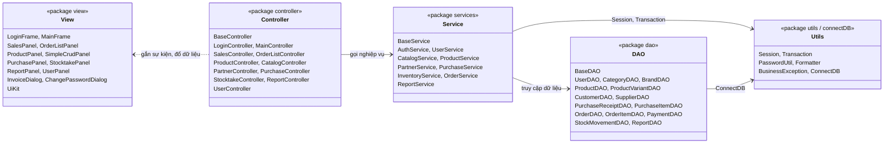
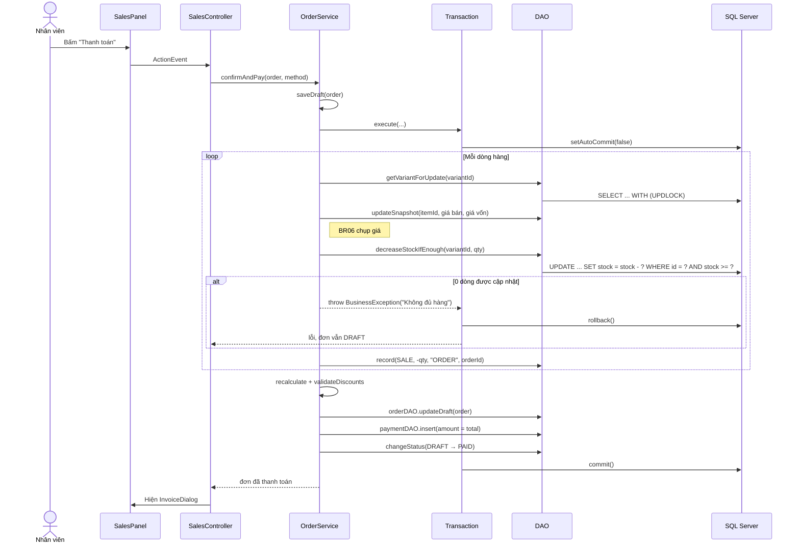

<div align="center">

**BỘ CÔNG THƯƠNG**
**TRƯỜNG ĐẠI HỌC ................................................**
**KHOA CÔNG NGHỆ THÔNG TIN**

--------

# BÁO CÁO MÔN HỌC
## Lập Trình Hướng Sự Kiện Với Công Nghệ Java

**CHỦ ĐỀ:**

# XÂY DỰNG HỆ THỐNG QUẢN LÝ CỬA HÀNG GIÀY DÉP

**Nhóm sinh viên thực hiện: Nhóm ...**

| STT | Họ tên SV | MSSV |
|:---:|---|---|
| 1. | ................................ | ............ |
| 2. | ................................ | ............ |
| 3. | ................................ | ............ |
| 4. | ................................ | ............ |

Tp. Hồ Chí Minh
Học kỳ ... Năm học: 2026 – 2027

</div>

---

## MỤC LỤC

- DANH MỤC CÁC HÌNH VẼ
- DANH MỤC CÁC BẢNG BIỂU
- CHƯƠNG 1. GIỚI THIỆU
  - I. Tổng quan
    - 1. Khảo sát hiện trạng
    - 2. Quy trình nghiệp vụ
  - II. Yêu cầu chức năng
  - III. Yêu cầu phi chức năng
- CHƯƠNG 2. PHÂN TÍCH
  - I. Thiết kế sơ đồ lớp (Class Diagram)
    - 1. Class Diagram
    - 2. Đặc tả Class Diagram
  - II. Thiết kế cơ sở dữ liệu
    - 1. Sơ đồ trên HQT CSDL
    - 2. Các ràng buộc toàn vẹn trong CSDL
- CHƯƠNG 3. HIỆN THỰC HOÁ
  - I. Kiến trúc chương trình
  - II. Thiết kế màn hình của ứng dụng
  - III. Chi tiết cài đặt các chức năng
- KẾT LUẬN

---

## DANH MỤC CÁC HÌNH VẼ

| Hình | Tên |
|---|---|
| Hình 1.1 | Sơ đồ Use Case |
| Hình 1.2 | Sơ đồ hoạt động luồng bán hàng tại quầy |
| Hình 1.3 | Sơ đồ trạng thái Đơn hàng |
| Hình 1.4 | Sơ đồ trạng thái Phiếu nhập |
| Hình 2.1 | Mô hình Class Diagram |
| Hình 2.2 | Sơ đồ trên Hệ quản trị CSDL |
| Hình 3.1 | Sơ đồ kiến trúc phân lớp |
| Hình 3.2 – 3.12 | Các màn hình của ứng dụng |
| Hình 3.13 | Sơ đồ tuần tự "Xác nhận thanh toán đơn hàng" |

## DANH MỤC CÁC BẢNG BIỂU

| Bảng | Tên |
|---|---|
| Bảng 1.1 | Vai trò và quyền hạn |
| Bảng 1.2 | Quy tắc nghiệp vụ |
| Bảng 2.1 – 2.13 | Đặc tả các lớp User, Category, Brand, Product, ProductVariant, Customer, Supplier, PurchaseReceipt, PurchaseItem, Order, OrderItem, Payment, StockMovement |
| Bảng 2.14 | Các kiểu liệt kê (enum) |
| Bảng 2.15 – 2.27 | Ràng buộc toàn vẹn CSDL của 13 bảng |
| Bảng 3.1 | Cấu trúc gói mã nguồn |
| Bảng 3.2 | Đối chiếu quy tắc nghiệp vụ với mã nguồn |

---

# CHƯƠNG 1. GIỚI THIỆU

## I. Tổng quan

### 1. Khảo sát hiện trạng

Cửa hàng giày dép là mô hình kinh doanh bán lẻ trực tiếp tại quầy các loại giày thể thao, giày chạy bộ, dép... của nhiều thương hiệu. Đặc thù của mặt hàng giày dép là **một mẫu giày được bán theo nhiều size và nhiều màu**, mỗi tổ hợp size – màu có số lượng tồn và có thể có giá riêng. Cửa hàng cần thực hiện các công việc: quản lý thông tin mẫu giày và từng biến thể size/màu, nhập hàng từ nhà cung cấp, theo dõi tồn kho, bán hàng – thanh toán – in hóa đơn, quản lý khách hàng và tổng hợp doanh thu, lợi nhuận. Các công việc do nhân viên bán hàng và người quản lý (chủ cửa hàng) phối hợp thực hiện.

Qua khảo sát, việc quản lý bằng sổ sách hoặc bảng tính gặp các hạn chế:

**Quản lý hàng hóa:** Một mẫu giày có hàng chục biến thể size/màu, rất khó theo dõi tồn kho chính xác cho từng size. Dễ xảy ra tình trạng khách hỏi size 42 nhưng không biết còn hay hết, hoặc hai mã hàng cho cùng một đôi giày.

**Nhập hàng và tồn kho:** Ghi nhận hàng nhập thủ công dễ cộng sai, cộng trùng. Không có lịch sử biến động kho nên khi kiểm kê thấy lệch thì không truy được nguyên nhân. Giá vốn thay đổi theo từng lần nhập nên khó tính lợi nhuận.

**Bán hàng và thanh toán:** Tra cứu size/màu, tính tiền, giảm giá thủ công mất thời gian và dễ sai. Nhân viên có thể giảm giá tùy tiện. Khi hai nhân viên cùng bán đôi cuối cùng có thể xảy ra bán vượt tồn.

**Thống kê doanh thu:** Tổng hợp doanh thu, lợi nhuận theo ngày/tháng/năm phải làm tay; khi giá bán thay đổi thì số liệu đơn cũ bị sai lệch nếu không lưu lại giá tại thời điểm bán.

Vì vậy, việc xây dựng phần mềm quản lý là cần thiết để giảm sai sót, kiểm soát tồn kho theo từng size/màu, kiểm soát giảm giá và hỗ trợ ra quyết định kinh doanh.

**Phạm vi đề tài:** Hệ thống là ứng dụng Desktop (Java Swing + SQL Server) phục vụ nội bộ **một cửa hàng**, với 2 nhóm người dùng là **Admin (quản lý)** và **Nhân viên bán hàng**. Hệ thống giải quyết các nghiệp vụ: quản lý sản phẩm theo size/màu, danh mục, thương hiệu; quản lý nhà cung cấp, nhập hàng, kiểm kê; bán hàng tại quầy, thanh toán, in hóa đơn, hủy đơn; quản lý khách hàng, tài khoản; báo cáo doanh thu, lợi nhuận, tồn kho.

**Ngoài phạm vi:** đổi trả hàng, bán hàng online, giao vận, thuế VAT / hóa đơn điện tử, nhiều kho/chi nhánh, chương trình khuyến mãi phức tạp.

**Bảng 1.1 Vai trò và quyền hạn**

| Vai trò | Được phép |
|---|---|
| Admin | Toàn quyền: quản lý tài khoản, danh mục, thương hiệu, sản phẩm và giá; hủy đơn đã thanh toán; giảm giá không giới hạn; xem giá vốn và báo cáo lợi nhuận |
| Nhân viên | Tra cứu sản phẩm, lập đơn và thanh toán, hủy đơn nháp, quản lý khách hàng và nhà cung cấp, nhập hàng, kiểm kê, xem báo cáo doanh thu và tồn kho; giảm giá tối đa 20% tổng đơn |

**Hình 1.1 Sơ đồ Use Case**



### 2. Quy trình nghiệp vụ

#### 2.1. Nghiệp vụ Đăng nhập và Phân quyền

- **Bước 1:** Người dùng mở chương trình, nhập tên đăng nhập và mật khẩu.
- **Bước 2:** Hệ thống tìm tài khoản theo tên đăng nhập, so khớp mật khẩu với chuỗi băm lưu trong CSDL và kiểm tra tài khoản còn hoạt động.
- **Bước 3:** Nếu hợp lệ, hệ thống lưu người dùng hiện tại và hiển thị giao diện theo vai trò:
  - Nhân viên: Bán hàng, Đơn hàng, Tra cứu sản phẩm, Khách hàng, Nhà cung cấp, Nhập hàng, Kiểm kê, Báo cáo (ẩn giá vốn, lợi nhuận).
  - Admin: toàn bộ chức năng trên, thêm Quản lý sản phẩm, Danh mục, Thương hiệu, Tài khoản và báo cáo lợi nhuận.
- **Bước 4:** Nếu sai thông tin hoặc tài khoản bị khóa, hệ thống báo lỗi và yêu cầu nhập lại.
- **Bước 5:** Người dùng có thể đổi mật khẩu hoặc đăng xuất từ menu Hệ thống.

#### 2.2. Nghiệp vụ Quản lý Sản phẩm

- **Bước 1:** Admin mở chức năng Sản phẩm, hệ thống hiển thị danh sách mẫu giày (tên, danh mục, thương hiệu, trạng thái).
- **Bước 2:** Admin tìm kiếm theo từ khóa (tên, thương hiệu, SKU, size, màu) và lọc theo danh mục, thương hiệu, trạng thái.
- **Bước 3:** Admin thao tác với **mẫu giày**: thêm mới, sửa thông tin, ngừng kinh doanh hoặc xóa.
- **Bước 4:** Chọn một mẫu giày, hệ thống hiển thị các **biến thể size/màu** (SKU, giá bán, giá vốn, tồn, ngưỡng tồn tối thiểu). Admin thêm, sửa giá bán, ngừng kinh doanh hoặc xóa biến thể.
- **Bước 5:** Hệ thống kiểm tra trước khi lưu: SKU không trùng, tổ hợp size + màu không trùng trong cùng mẫu (BR01).
- **Bước 6:** Khi xóa, nếu sản phẩm/biến thể đã phát sinh giao dịch thì hệ thống chỉ chuyển sang "ngừng kinh doanh", không xóa cứng (BR02).

#### 2.3. Nghiệp vụ Nhập hàng

- **Bước 1:** Nhân viên mở chức năng Nhập hàng, chọn nhà cung cấp.
- **Bước 2:** Tìm biến thể cần nhập, nhập số lượng và giá nhập, thêm vào danh sách dòng nhập. Hệ thống tính thành tiền và tổng tiền phiếu.
- **Bước 3:** Lưu phiếu ở trạng thái **Nháp**. Phiếu nháp có thể mở lại để sửa hoặc hủy. Tồn kho chưa thay đổi.
- **Bước 4:** Khi hàng đã về đủ, nhân viên **xác nhận** phiếu. Trong một giao dịch, hệ thống: chuyển phiếu sang CONFIRMED (chỉ một lần), tăng tồn từng biến thể, cập nhật giá vốn = giá nhập vừa nhập, ghi lịch sử biến động kho.
- **Bước 5:** Phiếu đã xác nhận không được sửa hay hủy; nếu sai thì điều chỉnh bằng kiểm kê (BR04).

#### 2.4. Nghiệp vụ Kiểm kê

- **Bước 1:** Nhân viên mở chức năng Kiểm kê, hệ thống hiển thị tồn hệ thống của mọi biến thể.
- **Bước 2:** Nhân viên đếm hàng thực tế và nhập vào cột "Thực tế"; hệ thống tự hiển thị chênh lệch.
- **Bước 3:** Nhân viên bấm "Tạo điều chỉnh chênh lệch", xác nhận danh sách thay đổi.
- **Bước 4:** Hệ thống đưa tồn về đúng số thực tế và ghi một dòng biến động loại ADJUSTMENT cho mỗi biến thể bị lệch.
- **Bước 5:** Nhân viên có thể xem lịch sử biến động kho và chạy "Đối soát" để phát hiện biến thể có tồn khác tổng lịch sử.

#### 2.5. Nghiệp vụ Bán hàng và Thanh toán tại quầy (POS)

- **Bước 1:** Nhân viên đăng nhập, mở màn hình Bán hàng; hệ thống tạo đơn mới ở trạng thái Nháp.
- **Bước 2:** Nhân viên tìm biến thể theo tên, SKU, thương hiệu, size, màu và thêm vào đơn. Hệ thống **cảnh báo sớm** nếu số lượng vượt tồn hoặc biến thể đã ngừng kinh doanh.
- **Bước 3:** Nhân viên sửa số lượng, xóa dòng, nhập giảm giá theo dòng hoặc theo đơn; tìm hoặc thêm nhanh khách hàng theo số điện thoại (không bắt buộc).
- **Bước 4:** Hệ thống tự tính tổng tiền = Σ(SL × đơn giá − giảm dòng) − giảm đơn (BR09) và kiểm tra giới hạn giảm giá (BR08).
- **Bước 5:** Khách trả tiền mặt (hệ thống tính tiền thối) hoặc chuyển khoản.
- **Bước 6:** Nhân viên bấm Thanh toán. Hệ thống, trong **một giao dịch**: kiểm tra tồn lần cuối, chụp giá bán và giá vốn vào từng dòng, trừ kho, ghi lịch sử kho, ghi thanh toán, chuyển đơn sang PAID.
- **Bước 7:** Hệ thống hiển thị hóa đơn để in. Nếu bước 6 lỗi, đơn vẫn là Nháp và kho không đổi.

**Hình 1.2 Sơ đồ hoạt động luồng bán hàng tại quầy**



#### 2.6. Nghiệp vụ Quản lý đơn hàng và Hủy đơn

- **Bước 1:** Người dùng mở chức năng Đơn hàng, lọc theo khoảng ngày, trạng thái, mã đơn hoặc tên/SĐT khách.
- **Bước 2:** Chọn một đơn để xem chi tiết các dòng hàng; có thể xem và in lại hóa đơn.
- **Bước 3:** Với đơn Nháp, có thể mở lại ở màn hình Bán hàng để tiếp tục.
- **Bước 4:** Hủy đơn: đơn Nháp hủy tự do, không ảnh hưởng kho. Đơn đã thanh toán chỉ Admin được hủy; hệ thống hoàn lại kho, ghi lịch sử loại CANCEL và chuyển đơn sang CANCELLED (BR11).

**Hình 1.3 Sơ đồ trạng thái Đơn hàng**



**Hình 1.4 Sơ đồ trạng thái Phiếu nhập**



#### 2.7. Nghiệp vụ Thống kê và Báo cáo

- **Bước 1:** Người dùng mở chức năng Báo cáo, chọn khoảng ngày, cách nhóm (ngày/tháng/năm) và số sản phẩm bán chạy cần xem.
- **Bước 2:** Hệ thống tổng hợp dữ liệu từ các đơn đã thanh toán và phiếu nhập đã xác nhận.
- **Bước 3:** Hệ thống hiển thị:
  - Doanh thu thuần, số đơn theo từng kỳ; giá vốn và **lợi nhuận gộp** (chỉ Admin).
  - Danh sách sản phẩm bán chạy theo số lượng.
  - Tồn kho của mọi biến thể (tô đỏ dòng dưới ngưỡng) và danh sách hàng dưới ngưỡng tồn tối thiểu kèm số lượng cần nhập thêm.
  - Tổng giá trị nhập và số phiếu nhập trong kỳ; giá trị tồn kho theo giá vốn (chỉ Admin).

#### 2.8. Quy tắc nghiệp vụ

**Bảng 1.2 Quy tắc nghiệp vụ**

| Mã | Nhóm | Quy tắc |
|---|---|---|
| BR01 | Sản phẩm | SKU là duy nhất. Mỗi biến thể là một tổ hợp size + màu của một Product, không trùng |
| BR02 | Sản phẩm | Product hoặc biến thể đã có trong đơn/phiếu nhập chỉ được chuyển sang ngừng kinh doanh, không được xóa. Biến thể ngừng kinh doanh không thể thêm vào đơn mới |
| BR03 | Tồn kho | Tồn kho không được âm. Mọi thay đổi tồn (nhập, bán, kiểm kê, hủy đơn) đều ghi một dòng StockMovement |
| BR04 | Tồn kho | Phiếu nhập chỉ làm tăng tồn khi chuyển sang CONFIRMED và chỉ được xác nhận một lần. Phiếu đã xác nhận không được sửa; sai thì kiểm kê |
| BR05 | Bán hàng | Chỉ xác nhận đơn khi tồn mọi dòng đủ. Kiểm tra, trừ kho, ghi thanh toán chạy trong một giao dịch; lỗi thì hoàn tác toàn bộ |
| BR06 | Bán hàng | Giá bán và giá vốn được chụp lại vào OrderItem tại thời điểm bán |
| BR07 | Giá vốn | Giá vốn = giá nhập gần nhất từ phiếu đã xác nhận. Lợi nhuận gộp = doanh thu thuần − Σ(giá vốn × SL) |
| BR08 | Giảm giá | Giảm theo số tiền trên dòng hoặc đơn, không vượt thành tiền. Nhân viên tối đa 20% tổng đơn; Admin không giới hạn |
| BR09 | Tính tiền | Tổng tiền = Σ(SL × đơn giá − giảm dòng) − giảm cấp đơn; luôn tính lại từ các dòng |
| BR10 | Thanh toán | Mỗi đơn có một Payment duy nhất, số tiền bằng tổng tiền đơn |
| BR11 | Hủy đơn | Đơn DRAFT hủy tự do. Đơn PAID chỉ Admin được hủy, hoàn kho và đánh dấu CANCELLED |
| BR12 | Phân quyền | Mỗi người dùng đúng một vai trò. Vai trò quyết định màn hình/nút hiển thị; Service vẫn kiểm tra lại quyền |

## II. Yêu cầu chức năng

### 1. Chức năng Đăng nhập và Phân quyền
- Đăng nhập bằng tên đăng nhập và mật khẩu (mật khẩu lưu dạng băm).
- Đăng xuất, đổi mật khẩu.
- Phân quyền chức năng theo vai trò Admin / Nhân viên.

### 2. Chức năng Quản lý Sản phẩm
- Thêm, sửa, ngừng kinh doanh, xóa mẫu giày (theo BR02).
- Thêm, sửa, ngừng kinh doanh, xóa biến thể size/màu; cập nhật giá bán, ngưỡng tồn tối thiểu.
- Tìm kiếm theo tên, thương hiệu, SKU, size, màu; lọc theo danh mục, thương hiệu, trạng thái.
- Nhân viên chỉ được tra cứu, không thấy giá vốn.

### 3. Chức năng Quản lý Danh mục, Thương hiệu (Admin)
- Thêm, sửa, ngừng sử dụng, xóa danh mục và thương hiệu; tên không trùng.

### 4. Chức năng Quản lý Khách hàng, Nhà cung cấp
- Thêm, sửa, xóa, tìm kiếm theo tên hoặc số điện thoại.
- Không xóa khách hàng đã có đơn, nhà cung cấp đã có phiếu nhập.

### 5. Chức năng Nhập hàng
- Lập, sửa, hủy phiếu nhập nháp; xác nhận phiếu nhập để tăng tồn.
- Xem danh sách phiếu nhập theo khoảng ngày, trạng thái; xem chi tiết phiếu.

### 6. Chức năng Kiểm kê
- Nhập số lượng thực tế, tạo điều chỉnh chênh lệch.
- Xem lịch sử biến động kho theo loại, SKU, khoảng ngày; đối soát tồn kho với lịch sử.

### 7. Chức năng Bán hàng và Thanh toán (POS)
- Tạo đơn, tìm và thêm biến thể, sửa số lượng, xóa dòng.
- Giảm giá theo dòng / theo đơn, gắn khách hàng (tìm hoặc thêm nhanh).
- Tự tính tổng tiền, tiền thối; thanh toán tiền mặt hoặc chuyển khoản.
- Lưu đơn nháp, hủy đơn nháp, in hóa đơn.

### 8. Chức năng Quản lý Đơn hàng
- Tìm đơn theo khoảng ngày, trạng thái, mã đơn, tên/SĐT khách; xem chi tiết.
- Mở lại đơn nháp, xem / in lại hóa đơn, hủy đơn theo BR11.

### 9. Chức năng Thống kê và Báo cáo
- Doanh thu, số đơn theo ngày/tháng/năm; giá vốn, lợi nhuận gộp (Admin).
- Sản phẩm bán chạy, tồn kho, hàng dưới ngưỡng, tổng giá trị nhập, giá trị tồn kho.

### 10. Chức năng Quản lý Tài khoản (Admin)
- Tạo tài khoản, sửa họ tên / vai trò / trạng thái, đặt lại mật khẩu.
- Không cho tự khóa hoặc tự hạ quyền; luôn còn ít nhất một Admin hoạt động.

## III. Yêu cầu phi chức năng

- **Hiệu suất:** Các thao tác tra cứu, lập đơn phản hồi nhanh; truy vấn dùng chỉ mục trên các cột lọc thường dùng.
- **Bảo mật:** Mật khẩu băm PBKDF2 có salt; phân quyền hai lớp (giao diện ẩn chức năng + Service kiểm tra lại quyền).
- **Toàn vẹn dữ liệu:** Thanh toán, xác nhận phiếu nhập, hủy đơn, kiểm kê chạy trong giao dịch JDBC (commit/rollback); trừ kho có điều kiện chống bán vượt tồn khi nhiều máy cùng bán; ràng buộc CHECK/UNIQUE trong CSDL.
- **Tương thích:** Chạy trên Windows 10/11 với Java 11 trở lên và SQL Server.
- **Dễ sử dụng:** Giao diện tiếng Việt, bố cục dạng tab theo chức năng, có tìm kiếm và lọc ở mọi danh sách.
- **Lưu trữ dữ liệu:** Dữ liệu lưu trên Microsoft SQL Server.
- **Xử lý lỗi:** Kiểm tra dữ liệu đầu vào, mọi lỗi nghiệp vụ hiển thị thông báo tiếng Việt rõ nguyên nhân.

---

# CHƯƠNG 2. PHÂN TÍCH

## I. Thiết kế sơ đồ lớp (Class Diagram)

### 1. Class Diagram

**Hình 2.1 Mô hình Class Diagram**



### 2. Đặc tả Class Diagram

**Quy ước chung cho mọi lớp:**
- Thuộc tính khai báo `private`, truy cập qua getter/setter `public`.
- Mỗi lớp có constructor rỗng `XXX()`.
- Các lớp model chỉ chứa dữ liệu; **việc kiểm tra ràng buộc được thực hiện tại tầng Service** (ném `BusinessException` với thông báo tiếng Việt) và được bảo vệ thêm bởi ràng buộc CHECK/UNIQUE trong CSDL. Cột "Nơi kiểm tra" ghi rõ phương thức thực hiện.
- Ngoài thuộc tính nghiệp vụ, một số lớp có thêm thuộc tính **chỉ để hiển thị** (ví dụ `productName`, `supplierName`), được DAO điền khi JOIN và không lưu xuống bảng.

#### a. Lớp User

**Bảng 2.1 Lớp User**

| STT | Công việc | Kiểu dữ liệu | Ràng buộc | Ghi chú / Nơi kiểm tra |
|---|---|---|---|---|
| 1 | **Khai báo thuộc tính** | | | |
| 1.1 | id | Long | Tự tăng | {id} |
| 1.2 | username | String | Không rỗng, 3–50 ký tự gồm chữ không dấu, số, `_`, `.`; không trùng | `UserService.create()` – "Tên đăng nhập ... đã tồn tại" |
| 1.3 | passwordHash | String | Chuỗi băm PBKDF2; mật khẩu gốc ≥ 6 ký tự | `UserService.validatePassword()` |
| 1.4 | fullName | String | Không rỗng | Họ tên người dùng |
| 1.5 | role | Role | Bắt buộc, ADMIN hoặc STAFF | "Phải chọn vai trò" (BR12) |
| 1.6 | active | boolean | true: hoạt động, false: khóa | Mặc định true |
| 2 | **Getter, setter** | | | getId/setId, getUsername/setUsername, ... isActive/setActive |
| 3 | **Constructor** | | | User() |
| 4 | **Phương thức khác** | | | |
| 4.1 | toString() | String | | Trả về "Họ tên (username)" |

#### b. Lớp Category

**Bảng 2.2 Lớp Category**

| STT | Công việc | Kiểu dữ liệu | Ràng buộc | Ghi chú / Nơi kiểm tra |
|---|---|---|---|---|
| 1 | **Khai báo thuộc tính** | | | |
| 1.1 | id | Long | Tự tăng | {id} |
| 1.2 | name | String | Không rỗng, không trùng (không phân biệt hoa thường) | `CatalogService.saveCategory()` – "Danh mục ... đã tồn tại" |
| 1.3 | active | boolean | true: đang dùng | Danh mục đã có sản phẩm thì chỉ ngừng dùng, không xóa |
| 2 | **Getter, setter** | | | |
| 3 | **Constructor** | | | Category() |
| 4.1 | toString() | String | | Trả về tên danh mục (hiển thị trong ComboBox) |

#### c. Lớp Brand

**Bảng 2.3 Lớp Brand**

| STT | Công việc | Kiểu dữ liệu | Ràng buộc | Ghi chú / Nơi kiểm tra |
|---|---|---|---|---|
| 1 | **Khai báo thuộc tính** | | | |
| 1.1 | id | Long | Tự tăng | {id} |
| 1.2 | name | String | Không rỗng, không trùng | `CatalogService.saveBrand()` |
| 1.3 | active | boolean | true: đang dùng | Thương hiệu đã có sản phẩm chỉ ngừng dùng |
| 2 | **Getter, setter** | | | |
| 3 | **Constructor** | | | Brand() |
| 4.1 | toString() | String | | Trả về tên thương hiệu |

#### d. Lớp Product

**Bảng 2.4 Lớp Product**

| STT | Công việc | Kiểu dữ liệu | Ràng buộc | Ghi chú / Nơi kiểm tra |
|---|---|---|---|---|
| 1 | **Khai báo thuộc tính** | | | |
| 1.1 | id | Long | Tự tăng | {id} |
| 1.2 | categoryId | Long | Bắt buộc chọn | `ProductService.saveProduct()` – "Phải chọn danh mục" |
| 1.3 | brandId | Long | Bắt buộc chọn | "Phải chọn thương hiệu" |
| 1.4 | name | String | Không rỗng | Tên mẫu giày |
| 1.5 | description | String | Cho phép null | Mô tả |
| 1.6 | active | boolean | true: đang bán, false: ngừng KD | Ngừng KD mẫu giày thì ngừng luôn mọi biến thể (BR02) |
| 1.7 | categoryName, brandName | String | | Chỉ để hiển thị |
| 2 | **Getter, setter** | | | |
| 3 | **Constructor** | | | Product() |
| 4.1 | toString() | String | | Trả về tên mẫu giày |

#### e. Lớp ProductVariant

**Bảng 2.5 Lớp ProductVariant**

| STT | Công việc | Kiểu dữ liệu | Ràng buộc | Ghi chú / Nơi kiểm tra |
|---|---|---|---|---|
| 1 | **Khai báo thuộc tính** | | | |
| 1.1 | id | Long | Tự tăng | {id} |
| 1.2 | productId | Long | Bắt buộc | Thuộc một mẫu giày |
| 1.3 | sku | String | Không rỗng, **không trùng**, tự chuyển chữ in hoa | `ProductService.saveVariant()` – "SKU ... đã tồn tại (BR01)" |
| 1.4 | size | String | Không rỗng | Tổ hợp size + color không trùng trong cùng Product (BR01) |
| 1.5 | color | String | Không rỗng | |
| 1.6 | sellingPrice | BigDecimal | > 0 | "Giá bán phải lớn hơn 0" |
| 1.7 | costPrice | BigDecimal | ≥ 0 | Giá vốn = giá nhập gần nhất (BR07); chỉ thay đổi khi xác nhận phiếu nhập |
| 1.8 | stockQuantity | int | ≥ 0 | Ban đầu = 0; chỉ thay đổi qua nhập/bán/kiểm kê/hủy đơn (BR03) |
| 1.9 | minStock | int | ≥ 0 | Ngưỡng cảnh báo tồn tối thiểu |
| 1.10 | active | boolean | true: đang bán | Biến thể ngừng KD không thêm vào đơn được (BR02) |
| 1.11 | productName, brandName | String | | Chỉ để hiển thị |
| 2 | **Getter, setter** | | | |
| 3 | **Constructor** | | | ProductVariant() |
| 4 | **Phương thức khác** | | | |
| 4.1 | isLowStock() | boolean | | true nếu stockQuantity < minStock |
| 4.2 | getDisplayName() | String | | "Tên mẫu - Size x - Màu" |
| 4.3 | toString() | String | | "SKU \| tên hiển thị" |

#### f. Lớp Customer

**Bảng 2.6 Lớp Customer**

| STT | Công việc | Kiểu dữ liệu | Ràng buộc | Ghi chú / Nơi kiểm tra |
|---|---|---|---|---|
| 1.1 | id | Long | Tự tăng | {id} |
| 1.2 | fullName | String | Không rỗng | `PartnerService.saveCustomer()` |
| 1.3 | phone | String | Cho phép null; nếu có: 9–11 chữ số, không trùng khách khác | "Số điện thoại đã thuộc khách hàng ..." |
| 2 | **Getter, setter** | | | |
| 3 | **Constructor** | | | Customer() |
| 4.1 | toString() | String | | "Họ tên - SĐT" |

#### g. Lớp Supplier

**Bảng 2.7 Lớp Supplier**

| STT | Công việc | Kiểu dữ liệu | Ràng buộc | Ghi chú / Nơi kiểm tra |
|---|---|---|---|---|
| 1.1 | id | Long | Tự tăng | {id} |
| 1.2 | name | String | Không rỗng | `PartnerService.saveSupplier()` |
| 1.3 | phone | String | Cho phép null; nếu có: 9–11 chữ số | |
| 2 | **Getter, setter** | | | |
| 3 | **Constructor** | | | Supplier() |
| 4.1 | toString() | String | | Trả về tên nhà cung cấp |

#### h. Lớp PurchaseReceipt

**Bảng 2.8 Lớp PurchaseReceipt**

| STT | Công việc | Kiểu dữ liệu | Ràng buộc | Ghi chú / Nơi kiểm tra |
|---|---|---|---|---|
| 1.1 | id | Long | Tự tăng | {id} |
| 1.2 | supplierId | Long | Bắt buộc | "Nhà cung cấp không được để trống!" |
| 1.3 | userId | Long | Bắt buộc | Người lập phiếu = người đăng nhập |
| 1.4 | createdAt | LocalDateTime | | Thời điểm lập |
| 1.5 | status | ReceiptStatus | DRAFT → CONFIRMED / CANCELLED | Chỉ xác nhận một lần (BR04) |
| 1.6 | totalAmount | BigDecimal | = Σ(SL × giá nhập) | Hệ thống tự tính |
| 1.7 | items | List\<PurchaseItem\> | Không rỗng, không lặp biến thể | `PurchaseService.validate()` |
| 1.8 | supplierName, userName | String | | Chỉ để hiển thị |
| 2 | **Getter, setter** | | | |
| 3 | **Constructor** | | | PurchaseReceipt() |

#### i. Lớp PurchaseItem

**Bảng 2.9 Lớp PurchaseItem**

| STT | Công việc | Kiểu dữ liệu | Ràng buộc | Ghi chú / Nơi kiểm tra |
|---|---|---|---|---|
| 1.1 | id | Long | Tự tăng | {id} |
| 1.2 | receiptId | Long | Bắt buộc | Thuộc phiếu nhập |
| 1.3 | variantId | Long | Bắt buộc | "Dòng nhập chưa chọn biến thể" |
| 1.4 | quantity | int | > 0 | "Số lượng nhập phải lớn hơn 0!" |
| 1.5 | unitCost | BigDecimal | ≥ 0 | "Đơn giá nhập không được nhỏ hơn 0!" |
| 1.6 | sku, variantName | String | | Chỉ để hiển thị |
| 2 | **Getter, setter** | | | |
| 3 | **Constructor** | | | PurchaseItem() |
| 4.1 | getLineTotal() | BigDecimal | | quantity × unitCost |

#### j. Lớp Order

**Bảng 2.10 Lớp Order**

| STT | Công việc | Kiểu dữ liệu | Ràng buộc | Ghi chú / Nơi kiểm tra |
|---|---|---|---|---|
| 1.1 | id | Long | Tự tăng | {id} |
| 1.2 | customerId | Long | Cho phép null | Khách lẻ nếu null |
| 1.3 | userId | Long | Bắt buộc | Nhân viên lập đơn |
| 1.4 | createdAt | LocalDateTime | | Thời điểm tạo đơn |
| 1.5 | status | OrderStatus | DRAFT → PAID / CANCELLED; PAID → CANCELLED (Admin) | `OrderService.cancelOrder()` (BR11) |
| 1.6 | discountAmount | BigDecimal | ≥ 0, ≤ tiền hàng sau giảm dòng; NV: tổng giảm ≤ 20% | `OrderService.validateDiscounts()` (BR08) |
| 1.7 | totalAmount | BigDecimal | Luôn tính lại, không nhập tay | `OrderService.recalculate()` (BR09) |
| 1.8 | items | List\<OrderItem\> | Không rỗng khi lưu | "Đơn hàng chưa có sản phẩm nào" |
| 1.9 | customerName, userName, paymentMethod | | | Chỉ để hiển thị |
| 2 | **Getter, setter** | | | |
| 3 | **Constructor** | | | Order() |

#### k. Lớp OrderItem

**Bảng 2.11 Lớp OrderItem**

| STT | Công việc | Kiểu dữ liệu | Ràng buộc | Ghi chú / Nơi kiểm tra |
|---|---|---|---|---|
| 1.1 | id | Long | Tự tăng | {id} |
| 1.2 | orderId | Long | Bắt buộc | |
| 1.3 | variantId | Long | Bắt buộc, biến thể đang kinh doanh | BR02 |
| 1.4 | quantity | int | > 0, ≤ tồn kho | Cảnh báo sớm khi thêm; kiểm tra lần cuối khi thanh toán (BR05) |
| 1.5 | unitPrice | BigDecimal | | **Ảnh chụp** giá bán tại thời điểm bán (BR06) |
| 1.6 | unitCost | BigDecimal | | **Ảnh chụp** giá vốn tại thời điểm bán (BR06) |
| 1.7 | discountAmount | BigDecimal | ≥ 0, ≤ quantity × unitPrice | "Giảm giá dòng ... vượt quá thành tiền (BR08)" |
| 1.8 | sku, variantName | String | | Chỉ để hiển thị |
| 2 | **Getter, setter** | | | |
| 3 | **Constructor** | | | OrderItem() |
| 4.1 | getGrossAmount() | BigDecimal | | quantity × unitPrice |
| 4.2 | getLineTotal() | BigDecimal | | quantity × unitPrice − discountAmount |

#### l. Lớp Payment

**Bảng 2.12 Lớp Payment**

| STT | Công việc | Kiểu dữ liệu | Ràng buộc | Ghi chú / Nơi kiểm tra |
|---|---|---|---|---|
| 1.1 | id | Long | Tự tăng | {id} |
| 1.2 | orderId | Long | Bắt buộc, mỗi đơn đúng một Payment | BR10 |
| 1.3 | amount | BigDecimal | = tổng tiền đơn | Gán tự động khi thanh toán |
| 1.4 | method | PaymentMethod | CASH hoặc TRANSFER | "Phải chọn phương thức thanh toán" |
| 1.5 | paidAt | LocalDateTime | | Thời điểm thanh toán |
| 2 | **Getter, setter** | | | |
| 3 | **Constructor** | | | Payment() |

#### m. Lớp StockMovement

**Bảng 2.13 Lớp StockMovement**

| STT | Công việc | Kiểu dữ liệu | Ràng buộc | Ghi chú / Nơi kiểm tra |
|---|---|---|---|---|
| 1.1 | id | Long | Tự tăng | {id} |
| 1.2 | variantId | Long | Bắt buộc | |
| 1.3 | type | MovementType | PURCHASE, SALE, ADJUSTMENT, CANCEL | |
| 1.4 | quantityChange | int | Dương: tăng tồn, âm: giảm tồn | Σ quantityChange = stockQuantity (đối soát) |
| 1.5 | refType | String | ORDER, PURCHASE_RECEIPT, STOCKTAKE | Loại chứng từ gốc |
| 1.6 | refId | Long | Cho phép null | Mã chứng từ gốc |
| 1.7 | createdAt | LocalDateTime | | Thời điểm phát sinh |
| 1.8 | sku, variantName | String | | Chỉ để hiển thị |
| 2 | **Getter, setter** | | | |
| 3 | **Constructor** | | | StockMovement() |

#### n. Các kiểu liệt kê (enum)

**Bảng 2.14 Các kiểu liệt kê**

| Enum | Giá trị (nhãn hiển thị) | Dùng trong |
|---|---|---|
| Role | ADMIN (Quản trị viên), STAFF (Nhân viên) | User |
| OrderStatus | DRAFT (Nháp), PAID (Đã thanh toán), CANCELLED (Đã hủy) | Order |
| ReceiptStatus | DRAFT (Nháp), CONFIRMED (Đã xác nhận), CANCELLED (Đã hủy) | PurchaseReceipt |
| PaymentMethod | CASH (Tiền mặt), TRANSFER (Chuyển khoản) | Payment |
| MovementType | PURCHASE (Nhập hàng), SALE (Bán hàng), ADJUSTMENT (Kiểm kê điều chỉnh), CANCEL (Hủy đơn hoàn kho) | StockMovement |

Mỗi enum có phương thức `getLabel()` và `toString()` trả về nhãn tiếng Việt để hiển thị; khi lưu xuống CSDL dùng `name()` (giá trị tiếng Anh).

## II. Thiết kế cơ sở dữ liệu

### 1. Sơ đồ trên HQT CSDL

**Hình 2.2 Sơ đồ trên Hệ quản trị CSDL**



### 2. Các ràng buộc toàn vẹn trong CSDL

Các ràng buộc dưới đây được khai báo trong file `database/schema.sql`.

#### a. Bảng users

**Bảng 2.15 Ràng buộc toàn vẹn CSDL bảng users**

| STT | Khóa | Trường | Kiểu dữ liệu | Ràng buộc | Ghi chú |
|---|---|---|---|---|---|
| 1 | PK | id | BIGINT | IDENTITY(1,1) | Mã người dùng |
| 2 | | username | VARCHAR(50) | NOT NULL UNIQUE | Tên đăng nhập |
| 3 | | password_hash | VARCHAR(255) | NOT NULL | Chuỗi băm PBKDF2 |
| 4 | | full_name | NVARCHAR(100) | NOT NULL | Họ tên |
| 5 | | role | VARCHAR(20) | NOT NULL CHECK (role IN ('ADMIN','STAFF')) | Một vai trò (BR12) |
| 6 | | active | BIT | NOT NULL DEFAULT 1 | 1: hoạt động, 0: khóa |

#### b. Bảng categories

**Bảng 2.16 Ràng buộc toàn vẹn CSDL bảng categories**

| STT | Khóa | Trường | Kiểu dữ liệu | Ràng buộc | Ghi chú |
|---|---|---|---|---|---|
| 1 | PK | id | BIGINT | IDENTITY(1,1) | Mã danh mục |
| 2 | | name | NVARCHAR(100) | NOT NULL | Tên danh mục |
| 3 | | active | BIT | NOT NULL DEFAULT 1 | 1: đang dùng |

#### c. Bảng brands

**Bảng 2.17 Ràng buộc toàn vẹn CSDL bảng brands**

| STT | Khóa | Trường | Kiểu dữ liệu | Ràng buộc | Ghi chú |
|---|---|---|---|---|---|
| 1 | PK | id | BIGINT | IDENTITY(1,1) | Mã thương hiệu |
| 2 | | name | NVARCHAR(100) | NOT NULL | Tên thương hiệu |
| 3 | | active | BIT | NOT NULL DEFAULT 1 | 1: đang dùng |

#### d. Bảng products

**Bảng 2.18 Ràng buộc toàn vẹn CSDL bảng products**

| STT | Khóa | Trường | Kiểu dữ liệu | Ràng buộc | Ghi chú |
|---|---|---|---|---|---|
| 1 | PK | id | BIGINT | IDENTITY(1,1) | Mã mẫu giày |
| 2 | FK | category_id | BIGINT | NULL, REFERENCES categories(id) | Danh mục |
| 3 | FK | brand_id | BIGINT | NULL, REFERENCES brands(id) | Thương hiệu |
| 4 | | name | NVARCHAR(200) | NOT NULL | Tên mẫu giày |
| 5 | | description | NVARCHAR(MAX) | NULL | Mô tả |
| 6 | | active | BIT | NOT NULL DEFAULT 1 | 1: đang bán, 0: ngừng KD |

#### e. Bảng product_variants

**Bảng 2.19 Ràng buộc toàn vẹn CSDL bảng product_variants**

| STT | Khóa | Trường | Kiểu dữ liệu | Ràng buộc | Ghi chú |
|---|---|---|---|---|---|
| 1 | PK | id | BIGINT | IDENTITY(1,1) | Mã biến thể |
| 2 | FK | product_id | BIGINT | NOT NULL, REFERENCES products(id) | Thuộc mẫu giày |
| 3 | | sku | VARCHAR(50) | NOT NULL UNIQUE | BR01 |
| 4 | | size | VARCHAR(20) | NOT NULL | UNIQUE (product_id, size, color) – BR01 |
| 5 | | color | NVARCHAR(50) | NOT NULL | |
| 6 | | selling_price | DECIMAL(18,2) | NOT NULL CHECK (selling_price >= 0) | Giá bán |
| 7 | | cost_price | DECIMAL(18,2) | NOT NULL DEFAULT 0 CHECK (cost_price >= 0) | Giá vốn (BR07) |
| 8 | | stock_quantity | INT | NOT NULL DEFAULT 0 CHECK (stock_quantity >= 0) | Tồn không âm (BR03) |
| 9 | | min_stock | INT | NOT NULL DEFAULT 5 CHECK (min_stock >= 0) | Ngưỡng tồn tối thiểu |
| 10 | | active | BIT | NOT NULL DEFAULT 1 | 1: đang bán |

#### f. Bảng customers

**Bảng 2.20 Ràng buộc toàn vẹn CSDL bảng customers**

| STT | Khóa | Trường | Kiểu dữ liệu | Ràng buộc | Ghi chú |
|---|---|---|---|---|---|
| 1 | PK | id | BIGINT | IDENTITY(1,1) | Mã khách hàng |
| 2 | | full_name | NVARCHAR(100) | NOT NULL | Họ tên |
| 3 | | phone | VARCHAR(20) | NULL | Số điện thoại |

#### g. Bảng suppliers

**Bảng 2.21 Ràng buộc toàn vẹn CSDL bảng suppliers**

| STT | Khóa | Trường | Kiểu dữ liệu | Ràng buộc | Ghi chú |
|---|---|---|---|---|---|
| 1 | PK | id | BIGINT | IDENTITY(1,1) | Mã nhà cung cấp |
| 2 | | name | NVARCHAR(150) | NOT NULL | Tên nhà cung cấp |
| 3 | | phone | VARCHAR(20) | NULL | Số điện thoại |

#### h. Bảng purchase_receipts

**Bảng 2.22 Ràng buộc toàn vẹn CSDL bảng purchase_receipts**

| STT | Khóa | Trường | Kiểu dữ liệu | Ràng buộc | Ghi chú |
|---|---|---|---|---|---|
| 1 | PK | id | BIGINT | IDENTITY(1,1) | Mã phiếu nhập |
| 2 | FK | supplier_id | BIGINT | NOT NULL, REFERENCES suppliers(id) | Nhà cung cấp |
| 3 | FK | user_id | BIGINT | NOT NULL, REFERENCES users(id) | Người lập |
| 4 | | created_at | DATETIME | NOT NULL DEFAULT GETDATE() | Ngày lập |
| 5 | | status | VARCHAR(20) | NOT NULL CHECK (status IN ('DRAFT','CONFIRMED','CANCELLED')) | BR04 |
| 6 | | total_amount | DECIMAL(18,2) | NOT NULL DEFAULT 0 | Tổng tiền nhập |

#### i. Bảng purchase_items

**Bảng 2.23 Ràng buộc toàn vẹn CSDL bảng purchase_items**

| STT | Khóa | Trường | Kiểu dữ liệu | Ràng buộc | Ghi chú |
|---|---|---|---|---|---|
| 1 | PK | id | BIGINT | IDENTITY(1,1) | |
| 2 | FK | receipt_id | BIGINT | NOT NULL, REFERENCES purchase_receipts(id) | Phiếu nhập |
| 3 | FK | variant_id | BIGINT | NOT NULL, REFERENCES product_variants(id) | Biến thể |
| 4 | | quantity | INT | NOT NULL CHECK (quantity > 0) | Số lượng nhập |
| 5 | | unit_cost | DECIMAL(18,2) | NOT NULL CHECK (unit_cost >= 0) | Giá nhập |

#### j. Bảng orders

**Bảng 2.24 Ràng buộc toàn vẹn CSDL bảng orders**

| STT | Khóa | Trường | Kiểu dữ liệu | Ràng buộc | Ghi chú |
|---|---|---|---|---|---|
| 1 | PK | id | BIGINT | IDENTITY(1,1) | Mã đơn |
| 2 | FK | customer_id | BIGINT | NULL, REFERENCES customers(id) | Khách hàng (không bắt buộc) |
| 3 | FK | user_id | BIGINT | NOT NULL, REFERENCES users(id) | Nhân viên lập đơn |
| 4 | | created_at | DATETIME | NOT NULL DEFAULT GETDATE() | Thời điểm tạo |
| 5 | | status | VARCHAR(20) | NOT NULL CHECK (status IN ('DRAFT','PAID','CANCELLED')) | Trạng thái |
| 6 | | discount_amount | DECIMAL(18,2) | NOT NULL DEFAULT 0 CHECK (discount_amount >= 0) | Giảm giá cấp đơn |
| 7 | | total_amount | DECIMAL(18,2) | NOT NULL DEFAULT 0 | Tổng thanh toán (BR09) |

#### k. Bảng order_items

**Bảng 2.25 Ràng buộc toàn vẹn CSDL bảng order_items**

| STT | Khóa | Trường | Kiểu dữ liệu | Ràng buộc | Ghi chú |
|---|---|---|---|---|---|
| 1 | PK | id | BIGINT | IDENTITY(1,1) | |
| 2 | FK | order_id | BIGINT | NOT NULL, REFERENCES orders(id) | Đơn hàng |
| 3 | FK | variant_id | BIGINT | NOT NULL, REFERENCES product_variants(id) | Biến thể |
| 4 | | quantity | INT | NOT NULL CHECK (quantity > 0) | Số lượng |
| 5 | | unit_price | DECIMAL(18,2) | NOT NULL | Giá bán tại thời điểm bán (BR06) |
| 6 | | unit_cost | DECIMAL(18,2) | NOT NULL | Giá vốn tại thời điểm bán (BR06) |
| 7 | | discount_amount | DECIMAL(18,2) | NOT NULL DEFAULT 0 CHECK (discount_amount >= 0) | Giảm giá dòng |

#### l. Bảng payments

**Bảng 2.26 Ràng buộc toàn vẹn CSDL bảng payments**

| STT | Khóa | Trường | Kiểu dữ liệu | Ràng buộc | Ghi chú |
|---|---|---|---|---|---|
| 1 | PK | id | BIGINT | IDENTITY(1,1) | |
| 2 | FK | order_id | BIGINT | NOT NULL UNIQUE, REFERENCES orders(id) | Một đơn một thanh toán (BR10) |
| 3 | | amount | DECIMAL(18,2) | NOT NULL | Số tiền |
| 4 | | method | VARCHAR(20) | NOT NULL CHECK (method IN ('CASH','TRANSFER')) | Phương thức |
| 5 | | paid_at | DATETIME | NOT NULL DEFAULT GETDATE() | Thời điểm thanh toán |

#### m. Bảng stock_movements

**Bảng 2.27 Ràng buộc toàn vẹn CSDL bảng stock_movements**

| STT | Khóa | Trường | Kiểu dữ liệu | Ràng buộc | Ghi chú |
|---|---|---|---|---|---|
| 1 | PK | id | BIGINT | IDENTITY(1,1) | |
| 2 | FK | variant_id | BIGINT | NOT NULL, REFERENCES product_variants(id) | Biến thể |
| 3 | | type | VARCHAR(20) | NOT NULL CHECK (type IN ('PURCHASE','SALE','ADJUSTMENT','CANCEL')) | Loại biến động |
| 4 | | quantity_change | INT | NOT NULL | +/- số lượng |
| 5 | | ref_type | VARCHAR(50) | NULL | ORDER / PURCHASE_RECEIPT / STOCKTAKE |
| 6 | | ref_id | BIGINT | NULL | Mã chứng từ |
| 7 | | created_at | DATETIME | NOT NULL DEFAULT GETDATE() | Thời điểm |

**Chỉ mục bổ sung:** `IX_orders_created (created_at, status)`, `IX_order_items_order (order_id)`, `IX_purchase_items_receipt (receipt_id)`, `IX_stock_movements_variant (variant_id, created_at)` – tăng tốc báo cáo và tra cứu lịch sử.

---

# CHƯƠNG 3. HIỆN THỰC HOÁ

## I. Kiến trúc chương trình

Chương trình chia 5 tầng theo yêu cầu đặc tả: **View** (JFrame/JPanel) – **Controller** (xử lý sự kiện) – **Service** (nghiệp vụ) – **DAO** (JDBC) – **Model**. View không gọi SQL trực tiếp.

**Hình 3.1 Sơ đồ kiến trúc phân lớp**



**Bảng 3.1 Cấu trúc gói mã nguồn**

| Gói | Nội dung |
|---|---|
| `app` | `Main` – khởi động, đặt giao diện Nimbus, mở màn hình đăng nhập |
| `connectDB` | `ConnectDB` – kết nối SQL Server dùng chung, đọc `db.properties` |
| `model` | 13 lớp nghiệp vụ và 5 enum |
| `dto` | `RevenueRow`, `ProductSalesRow` – dữ liệu báo cáo |
| `dao` | `BaseDAO` và 14 DAO |
| `services` | `BaseService` và 9 Service |
| `controller` | `BaseController` và 11 Controller |
| `view` | `UiKit` và các JFrame/JPanel/JDialog |
| `utils` | `Session`, `Transaction`, `PasswordUtil`, `Formatter`, `BusinessException` |

**Các lớp hạ tầng chính:**
- `ConnectDB`: dùng **một kết nối chung** cho toàn ứng dụng, tự kết nối lại khi cần; khi lỗi hiển thị nguyên nhân gốc cho người dùng.
- `Transaction.execute(conn -> {...})`: tắt auto-commit, chạy khối lệnh, `commit()` khi thành công, `rollback()` khi có bất kỳ lỗi nào. Vì mọi DAO dùng chung kết nối nên các lệnh DAO trong khối tự thuộc cùng một giao dịch.
- `BaseDAO`: DAO không đóng Connection, chỉ đóng Statement/ResultSet và ném `SQLException` lên Service.
- `BaseService.db(...)`: đổi `SQLException` thành `BusinessException` tiếng Việt.
- `BaseController.handle(...)`: chạy hành động người dùng, bắt `BusinessException` và hiện hộp thoại lỗi.
- `Session`: lưu người dùng đăng nhập; `requireLogin()`, `requireAdmin()` dùng ở đầu mọi phương thức Service (BR12).
- `PasswordUtil`: băm mật khẩu PBKDF2WithHmacSHA256, salt ngẫu nhiên, 65 536 vòng lặp.

## II. Thiết kế màn hình của ứng dụng

> Ghi chú: chèn ảnh chụp màn hình thật vào vị trí các hình dưới đây.

### 1. Màn hình Đăng nhập

**Hình 3.2 Màn hình Đăng nhập**

Mô tả sơ lược: Người dùng nhập tên đăng nhập, mật khẩu và bấm "Đăng nhập" (hoặc Enter). Sai thông tin hoặc tài khoản bị khóa thì hiện thông báo lỗi. Đăng nhập thành công mở cửa sổ chính với các tab theo vai trò. Thanh trạng thái dưới cùng cửa sổ chính hiển thị người đang đăng nhập; menu "Hệ thống" có Đổi mật khẩu, Đăng xuất, Thoát.

### 2. Màn hình Bán hàng

**Hình 3.3 Màn hình Bán hàng**

Mô tả sơ lược:
- **Khối tìm sản phẩm (bên trái):** tìm biến thể đang bán theo tên/SKU/thương hiệu, size, màu; chọn số lượng và bấm "Thêm vào đơn" hoặc nhấp đúp dòng.
- **Khối đơn hàng (bên phải, trên):** danh sách dòng hàng; các nút "Sửa SL", "Giảm giá dòng", "Xóa dòng".
- **Khối khách hàng và giảm giá:** tìm khách theo SĐT/tên, thêm khách mới, bỏ khách; nhập giảm giá đơn.
- **Khối thanh toán:** chọn tiền mặt / chuyển khoản; nhập tiền khách đưa để tính tiền thối; tổng tiền hàng, tổng giảm giá, tổng thanh toán.
- **Nút chức năng:** Đơn mới, Lưu nháp, Thanh toán, Hủy đơn. Thanh toán thành công hiển thị hộp thoại hóa đơn có nút In.

### 3. Màn hình Đơn hàng

**Hình 3.4 Màn hình Đơn hàng**

Mô tả sơ lược: lọc đơn theo khoảng ngày, trạng thái, mã đơn hoặc khách; chọn đơn để xem chi tiết dòng hàng phía dưới; các nút "Xem / In hóa đơn", "Mở đơn nháp" (chuyển sang màn hình Bán hàng), "Hủy đơn".

### 4. Màn hình Quản lý Sản phẩm

**Hình 3.5 Màn hình Quản lý Sản phẩm**

Mô tả sơ lược:
- **Khối trên:** thanh tìm kiếm và lọc; bảng mẫu giày; form thông tin mẫu giày (tên, danh mục, thương hiệu, mô tả, đang kinh doanh) với nút Thêm mới, Lưu sản phẩm, Xóa / Ngừng KD.
- **Khối dưới:** bảng biến thể của mẫu đang chọn; form biến thể (SKU, size, màu, giá bán, tồn tối thiểu, đang kinh doanh) với nút Thêm mới, Lưu biến thể, Xóa / Ngừng KD.
- Với nhân viên, màn hình chỉ để tra cứu: hai form bị ẩn, cột giá vốn bị ẩn.

### 5. Màn hình Danh mục, Thương hiệu, Khách hàng, Nhà cung cấp

**Hình 3.6 Màn hình Nhà cung cấp** (các màn hình còn lại cùng bố cục)

Mô tả sơ lược: ô tìm kiếm, bảng danh sách bên trái, form thông tin bên phải với nút Thêm mới, Lưu, Xóa.

### 6. Màn hình Nhập hàng

**Hình 3.7 Màn hình Lập phiếu nhập** – **Hình 3.8 Màn hình Danh sách phiếu nhập**

Mô tả sơ lược:
- **Tab Lập phiếu nhập:** chọn nhà cung cấp; tìm biến thể (chọn dòng thì ô giá nhập tự gợi ý giá vốn hiện tại), nhập SL, giá nhập, "Thêm dòng"; bảng dòng nhập và tổng tiền; nút Phiếu mới, Lưu nháp, Lưu & Xác nhận nhập kho.
- **Tab Danh sách phiếu nhập:** lọc theo ngày, trạng thái; xem chi tiết phiếu; nút Sửa phiếu nháp, Xác nhận nhập kho, Hủy phiếu.

### 7. Màn hình Kiểm kê

**Hình 3.9 Màn hình Kiểm kê** – **Hình 3.10 Màn hình Lịch sử biến động**

Mô tả sơ lược:
- **Tab Kiểm kê:** bảng tồn hệ thống, cột "Thực tế" nhập trực tiếp, cột "Chênh lệch" tự tính; lọc nhanh, tùy chọn chỉ hiện dòng chênh lệch; nút "Tạo điều chỉnh chênh lệch", "Đối soát tồn kho".
- **Tab Lịch sử biến động:** lọc theo loại, SKU, khoảng ngày; hiển thị thời gian, SKU, loại, số lượng thay đổi, chứng từ.

### 8. Màn hình Báo cáo

**Hình 3.11 Màn hình Báo cáo**

Mô tả sơ lược: chọn khoảng ngày, cách nhóm (ngày/tháng/năm), số sản phẩm bán chạy và bấm "Xem báo cáo". Các tab: Doanh thu (kèm giá vốn, lợi nhuận gộp với Admin), Bán chạy, Tồn kho (dòng dưới ngưỡng tô đỏ), Dưới ngưỡng tồn, Nhập hàng.

### 9. Màn hình Quản lý Tài khoản

**Hình 3.12 Màn hình Quản lý Tài khoản**

Mô tả sơ lược: bảng tài khoản; form tên đăng nhập, họ tên, vai trò, trạng thái, mật khẩu ban đầu; nút Thêm mới, Lưu, Đặt lại mật khẩu. Chỉ Admin thấy màn hình này.

## III. Chi tiết cài đặt các chức năng

### 1. Đăng nhập và phân quyền

| Tầng | Lớp |
|---|---|
| View | LoginFrame, MainFrame, ChangePasswordDialog |
| Controller | LoginController, MainController |
| Service | AuthService |
| DAO | UserDAO |

- `AuthService.login()`: tìm user theo username → `PasswordUtil.verify()` → kiểm tra `active` → `Session.setCurrentUser()`. Sai tài khoản hay sai mật khẩu đều báo chung một thông báo.
- `MainController` tạo các tab theo vai trò; tab Danh mục, Thương hiệu, Tài khoản chỉ thêm khi `Session.isAdmin()`. Mỗi tab có hàm `refresh` nạp lại dữ liệu khi người dùng chuyển tới.
- Phân quyền hai lớp: mọi Service gọi `Session.requireLogin()` / `requireAdmin()` ở dòng đầu.

### 2. Quản lý tài khoản

| Tầng | Lớp |
|---|---|
| View / Controller | UserPanel / UserController |
| Service / DAO | UserService / UserDAO |

- `create()`: kiểm tra username hợp lệ và chưa tồn tại, mật khẩu ≥ 6 ký tự, băm trước khi lưu.
- `update()`: không cho tự khóa / tự hạ quyền; không để mất Admin cuối cùng (`countActiveAdmins()`).
- `resetPassword()`: Admin đặt lại mật khẩu.

### 3. Quản lý sản phẩm (BR01, BR02)

| Tầng | Lớp |
|---|---|
| View / Controller | ProductPanel / ProductController |
| Service | ProductService |
| DAO | ProductDAO, ProductVariantDAO |

- Tìm kiếm: `ProductDAO.searchProducts()` dùng mẫu `(? IS NULL OR cột = ?)` để một câu SQL phục vụ mọi tổ hợp bộ lọc.
- `saveVariant()`: kiểm tra SKU (`existsSku`) và size + màu (`existsSizeColor`) không trùng, có tham số `excludeId` để khi sửa không báo trùng chính nó; thêm mới thì tồn = 0; sửa thì không đổi tồn và giá vốn.
- Xóa (BR02):

```java
// ProductService.deleteProduct()
return Transaction.execute(conn -> {
    if (productDAO.hasTransactions(productId)) {   // có trong đơn / phiếu nhập / lịch sử kho
        productDAO.updateProductStatus(productId, false);
        variantDAO.deactivateByProduct(productId);  // ngừng luôn mọi biến thể
        return false;                               // chỉ ngừng kinh doanh
    }
    productDAO.deleteProduct(productId);            // chưa giao dịch -> xóa hẳn
    return true;
});
```

### 4. Danh mục, thương hiệu, khách hàng, nhà cung cấp

| Chức năng | View | Controller | Service | DAO |
|---|---|---|---|---|
| Danh mục / Thương hiệu | SimpleCrudPanel | CatalogController | CatalogService | CategoryDAO, BrandDAO |
| Khách hàng / Nhà cung cấp | SimpleCrudPanel | PartnerController | PartnerService | CustomerDAO, SupplierDAO |

- `SimpleCrudPanel` là khung giao diện dùng chung, mỗi màn hình chỉ khác tiêu đề và cột.
- Danh mục/thương hiệu: tên không trùng; đã có sản phẩm thì chỉ ngừng dùng.
- Khách hàng: SĐT không trùng; không xóa khách đã có đơn. Nhà cung cấp: không xóa nếu đã có phiếu nhập.

### 5. Nhập hàng (BR03, BR04, BR07)

| Tầng | Lớp |
|---|---|
| View / Controller | PurchasePanel / PurchaseController |
| Service | PurchaseService |
| DAO | PurchaseReceiptDAO, PurchaseItemDAO, ProductVariantDAO, StockMovementDAO |

- `createPurchaseReceipt()`: kiểm tra dữ liệu, tính tổng, lưu phiếu **DRAFT** và các dòng trong một giao dịch; tồn chưa đổi.
- `updateDraft()`: `UPDATE ... WHERE id = ? AND status = 'DRAFT'`; 0 dòng nghĩa là phiếu đã xác nhận/hủy → báo lỗi.
- `confirmReceipt()`:

```java
Transaction.execute(conn -> {
    // Đổi trạng thái có điều kiện -> chỉ xác nhận MỘT lần (BR04)
    if (!purchaseReceiptDAO.changeStatus(id, DRAFT, CONFIRMED))
        throw new BusinessException("Phiếu không ở trạng thái Nháp ...");
    for (PurchaseItem item : purchaseItemDAO.findByReceiptId(id)) {
        productVariantDAO.increaseStock(item.getVariantId(), item.getQuantity());   // tăng tồn
        productVariantDAO.updateCostPrice(item.getVariantId(), item.getUnitCost()); // BR07
        stockMovementDAO.record(item.getVariantId(), PURCHASE, item.getQuantity(),
                "PURCHASE_RECEIPT", id);                                             // BR03
    }
    return null;
});
```

- `cancelReceipt()`: chỉ DRAFT → CANCELLED.

### 6. Kiểm kê (BR03)

| Tầng | Lớp |
|---|---|
| View / Controller | StocktakePanel / StocktakeController |
| Service | InventoryService |
| DAO | ProductVariantDAO, StockMovementDAO |

```java
// InventoryService.applyStocktake(Map<variantId, actual>)
Transaction.execute(conn -> {
    for (each variantId, actual) {
        ProductVariant v = variantDAO.getVariantForUpdate(variantId); // WITH (UPDLOCK, ROWLOCK)
        int diff = actual - v.getStockQuantity();
        if (diff == 0) continue;
        variantDAO.updateStock(v.getId(), actual);
        movementDAO.record(v.getId(), ADJUSTMENT, diff, "STOCKTAKE", null);
    }
});
```

- `getVariantForUpdate` khóa dòng tới hết giao dịch để máy khác đang bán không làm sai số.
- `reconcile()`: so `stock_quantity` với `SUM(quantity_change)` và liệt kê biến thể lệch.

### 7. Bán hàng tại quầy (BR02, BR05, BR06, BR08, BR09, BR10)

| Tầng | Lớp |
|---|---|
| View | SalesPanel, InvoiceDialog |
| Controller | SalesController |
| Service | OrderService, ProductService, PartnerService |
| DAO | OrderDAO, OrderItemDAO, PaymentDAO, ProductVariantDAO, StockMovementDAO, CustomerDAO |

- `addItem()`: từ chối biến thể ngừng KD; cộng dồn nếu đã có; cảnh báo nếu vượt tồn.
- Tính tiền và giảm giá:

```java
// BR09 – OrderService.recalculate()
subtotal = Σ (quantity × unitPrice − discountLine)
total    = subtotal − orderDiscount

// BR08 – OrderService.validateDiscounts(order, user)
discountLine  ≤ quantity × unitPrice     (từng dòng, không âm)
orderDiscount ≤ subtotal                 (không âm)
if (user là STAFF)
    (Σ discountLine + orderDiscount) ≤ 20% × Σ(quantity × unitPrice)
```

- `confirmAndPay()`: lưu nháp trước (giao dịch riêng), sau đó chạy giao dịch xác nhận như sơ đồ dưới. Trừ kho bằng câu lệnh có điều kiện `UPDATE ... SET stock_quantity = stock_quantity - ? WHERE id = ? AND stock_quantity >= ?`; nếu 0 dòng được cập nhật thì báo hết hàng và rollback.

**Hình 3.13 Sơ đồ tuần tự "Xác nhận thanh toán đơn hàng"**



- `buildInvoice()` tạo hóa đơn dạng văn bản; `InvoiceDialog` hiển thị và in qua `JTextArea.print()`.

### 8. Quản lý đơn hàng và hủy đơn (BR11)

| Tầng | Lớp |
|---|---|
| View / Controller | OrderListPanel / OrderListController |
| Service | OrderService |
| DAO | OrderDAO, OrderItemDAO, ProductVariantDAO, StockMovementDAO |

```java
// OrderService.cancelOrder()
if (status == DRAFT) {
    orderDAO.changeStatus(id, DRAFT, CANCELLED);   // tự do, không đụng kho
    return;
}
if (!Session.isAdmin()) throw new BusinessException("Chỉ Admin được hủy đơn đã thanh toán (BR11).");
Transaction.execute(conn -> {
    orderDAO.changeStatus(id, PAID, CANCELLED);
    for (OrderItem it : itemDAO.findByOrderId(id)) {
        variantDAO.increaseStock(it.getVariantId(), it.getQuantity());   // hoàn kho
        movementDAO.record(it.getVariantId(), CANCEL, it.getQuantity(), "ORDER", id);
    }
    return null;
});
```

"Mở đơn nháp": `MainController` truyền cho `OrderListController` một hàm callback chuyển sang tab Bán hàng và gọi `SalesController.openDraft(id)`.

### 9. Báo cáo (BR07, BR12)

| Tầng | Lớp |
|---|---|
| View / Controller | ReportPanel / ReportController |
| Service | ReportService |
| DAO / DTO | ReportDAO, ProductVariantDAO / RevenueRow, ProductSalesRow |

```sql
-- ReportDAO.revenueByPeriod(): n = 10 (ngày), 7 (tháng), 4 (năm)
SELECT CONVERT(VARCHAR(n), o.created_at, 120) AS period,
       COUNT(*) AS order_count,
       SUM(o.total_amount) AS revenue,
       SUM(c.cost) AS cost
FROM orders o
CROSS APPLY (SELECT ISNULL(SUM(oi.quantity * oi.unit_cost), 0) AS cost
             FROM order_items oi WHERE oi.order_id = o.id) c
WHERE o.status = 'PAID' AND o.created_at >= ? AND o.created_at < ?
GROUP BY CONVERT(VARCHAR(n), o.created_at, 120)
```

- Lợi nhuận gộp = revenue − cost (`RevenueRow.getGrossProfit()`).
- Bán chạy: `SELECT TOP (?)` nhóm theo biến thể. Dưới ngưỡng: `stock_quantity < min_stock`.
- Với nhân viên: Service đặt `cost = null`, `inventoryValue()` yêu cầu Admin, giao diện ẩn cột giá vốn và lợi nhuận.

### 10. Đối chiếu quy tắc nghiệp vụ với mã nguồn

**Bảng 3.2 Đối chiếu quy tắc nghiệp vụ với mã nguồn**

| Quy tắc | Service | DAO / Database |
|---|---|---|
| BR01 | ProductService.saveVariant | existsSku, existsSizeColor; UNIQUE trong DB |
| BR02 | ProductService.deleteProduct/deleteVariant/saveProduct; OrderService.addItem/saveDraft/confirmAndPay | hasTransactions, deactivateByProduct |
| BR03 | PurchaseService, InventoryService, OrderService | decreaseStockIfEnough, StockMovementDAO.record; CHECK stock_quantity >= 0 |
| BR04 | PurchaseService.confirmReceipt/updateDraft/cancelReceipt | PurchaseReceiptDAO.changeStatus/updateDraft |
| BR05 | OrderService.confirmAndPay | Transaction, getVariantForUpdate, decreaseStockIfEnough |
| BR06 | OrderService.confirmAndPay | OrderItemDAO.updateSnapshot |
| BR07 | PurchaseService.confirmReceipt, ReportService.revenue | updateCostPrice, ReportDAO.revenueByPeriod |
| BR08 | OrderService.validateDiscounts | — |
| BR09 | OrderService.recalculate | — |
| BR10 | OrderService.confirmAndPay | PaymentDAO.existsForOrder/insert; UNIQUE payments.order_id |
| BR11 | OrderService.cancelOrder | OrderDAO.changeStatus, increaseStock |
| BR12 | Session.requireLogin/requireAdmin trong các Service | MainController, setAdminMode của các Panel |

---

# KẾT LUẬN

**Kết quả đạt được:**
- Xây dựng được ứng dụng Desktop Java Swing kết nối SQL Server, đáp ứng bốn nhóm chức năng: quản lý sản phẩm theo size/màu, nhập hàng – kiểm kê, bán hàng tại quầy, báo cáo.
- Cài đặt đầy đủ 12 quy tắc nghiệp vụ BR01–BR12, trong đó các thao tác quan trọng (thanh toán, xác nhận phiếu nhập, hủy đơn, kiểm kê) chạy trong giao dịch JDBC và chống bán vượt tồn khi nhiều máy cùng dùng.
- Kiến trúc phân tầng rõ ràng View – Controller – Service – DAO – Model; mật khẩu được băm, phân quyền hai lớp.

**Hạn chế:**
- Chưa hỗ trợ đổi trả hàng, khuyến mãi theo chương trình, nhiều kho/chi nhánh.
- Hóa đơn in dạng văn bản đơn giản; báo cáo chưa có biểu đồ.

**Hướng phát triển:**
- Bổ sung đổi trả hàng, mã giảm giá, tích điểm khách hàng.
- Thêm biểu đồ doanh thu, xuất báo cáo ra Excel/PDF.
- Hỗ trợ quét mã vạch SKU khi bán hàng.
